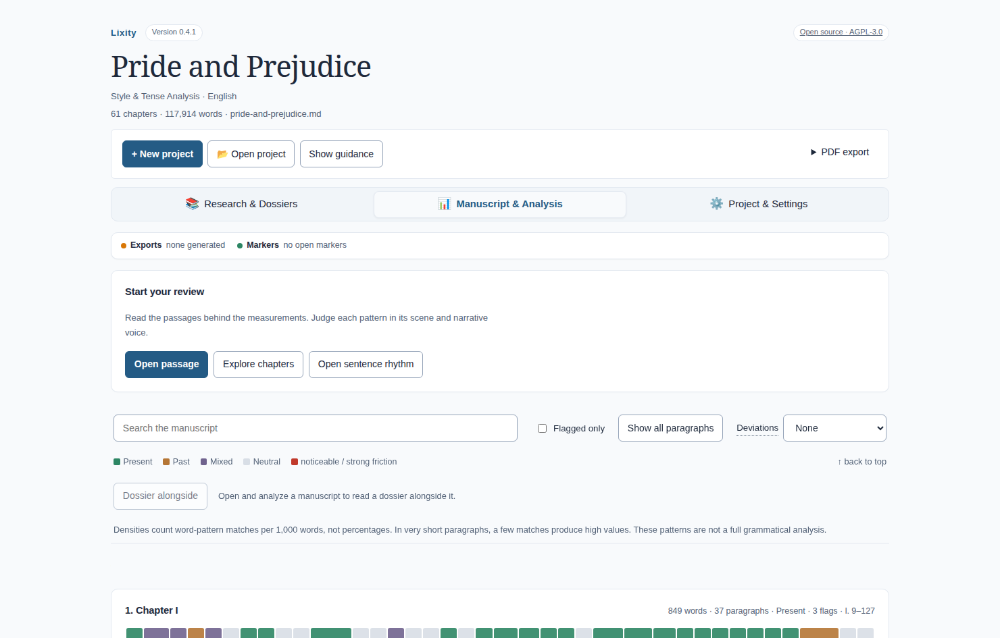
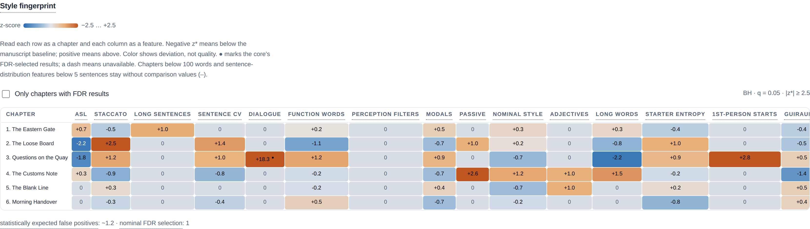
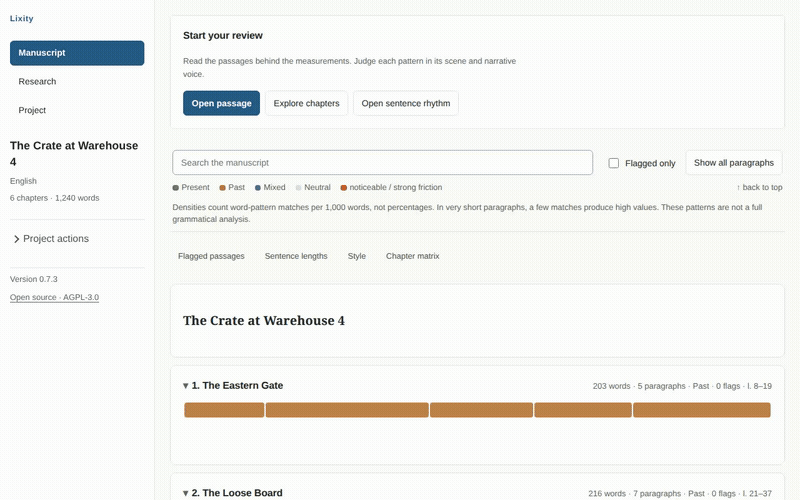
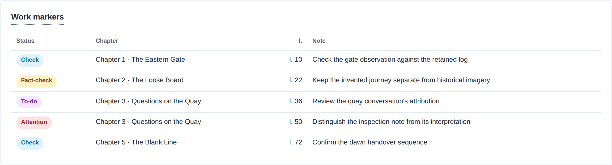
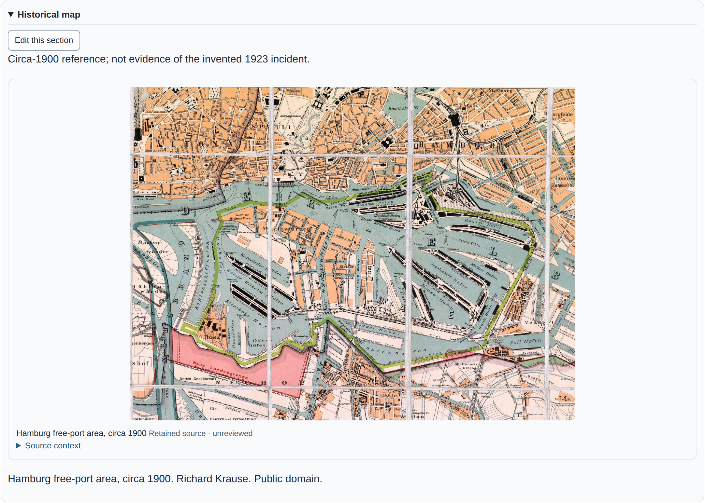
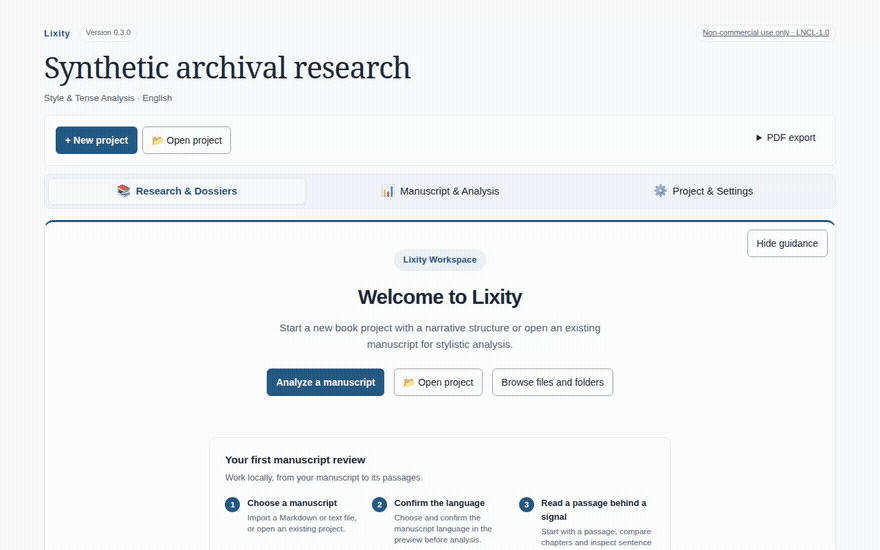
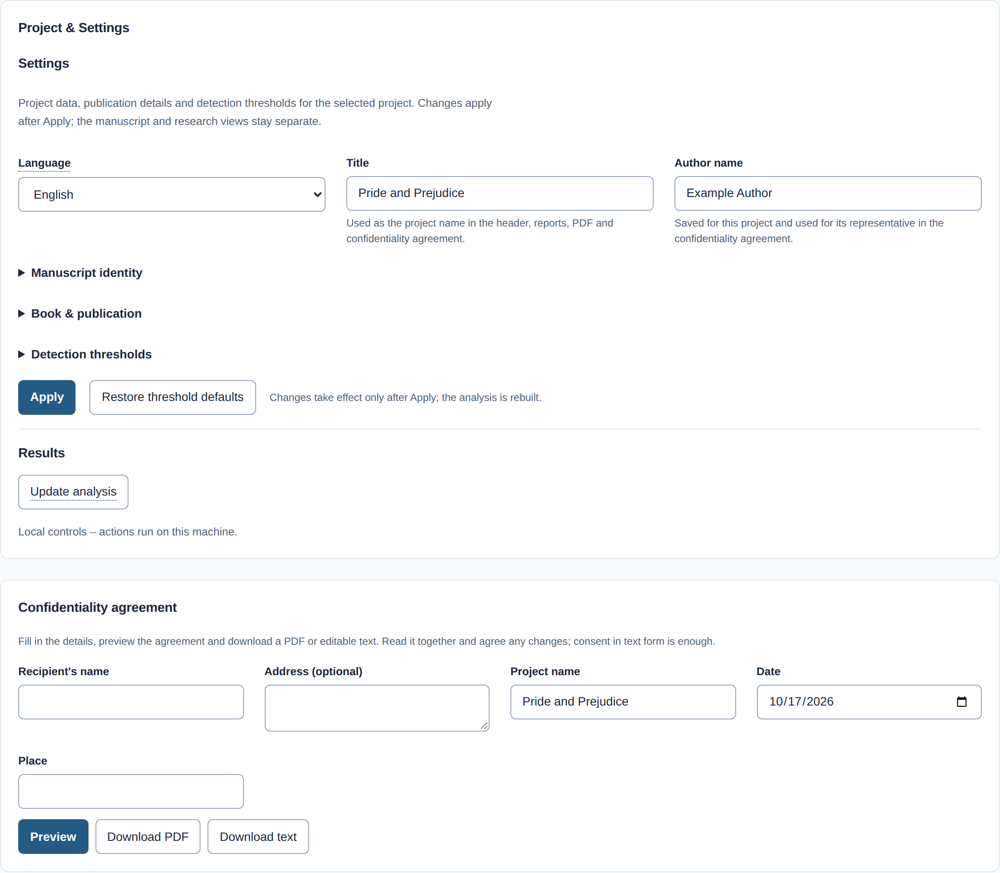
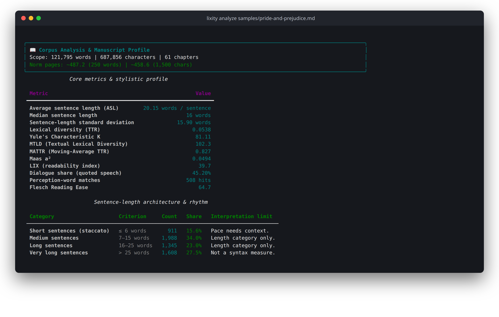

# Lixity

[](https://github.com/mfahsold/lixity/actions)
[](https://pypi.org/project/lixity/)
[](https://doi.org/10.5281/zenodo.23390297)


**Read the patterns in your writing. Keep the evidence behind your decisions.**

Lixity helps authors, editors and researchers see how a manuscript changes from
chapter to chapter. It measures sentence lengths, word use, dialogue and tense,
then lets you read the passages behind each result. Its research workspace keeps
source quotations and writing decisions connected. Your literary judgment guides
what you keep or revise.

Matthias Fahsold developed Lixity as an architect and developer at ROST Services
GmbH and used it while writing his own debut novel.

[Try the example](https://mfahsold.github.io/lixity/demo/report.html) ·
[Three-minute first look](https://mfahsold.github.io/lixity/guides/first-look.html) ·
[Install](#install-and-start) · [What you can do](#what-you-can-do) ·
[Practical guides](https://mfahsold.github.io/lixity/#guides) ·
[v0.4.9 release notes](docs/releases/v0.4.9.md)

The example is a read-only report made from invented text. It needs no
installation or manuscript upload. Documentation is English; you can read the
results in German, English, French, Spanish, Italian, Portuguese or Dutch.

## Start here

No statistics background is needed, and nothing is uploaded: analysis runs on
your computer.

1. **Look at an example.** The [read-only synthetic report](https://mfahsold.github.io/lixity/demo/report.html)
   opens directly in the browser and is made from invented text. For real books,
   the [Effi Briest example](https://mfahsold.github.io/lixity/examples/effi-briest.html)
   (German) and the [Pride and Prejudice example](https://mfahsold.github.io/lixity/examples/pride-and-prejudice.html)
   (English) show an interactive excerpt of a public-domain novel next to its
   complete PDF report.
2. **See what the numbers mean.** The [three-minute first look](https://mfahsold.github.io/lixity/guides/first-look.html)
   walks through chapter comparison, a passage and its measurements.
3. **Install Lixity** when you want to analyze your own manuscript (next section).

## Install and start

Lixity runs on Windows, macOS and Linux. Use [uv](https://docs.astral.sh/uv/);
it supplies the managed Python environment and installs the published package
from [PyPI](https://pypi.org/project/lixity/). For help installing uv or
advanced installation options, follow the
[installation guide](docs/INSTALLATION.md) (it also documents the pinned
release wheel with `SHA256SUMS` for reproducible setups).

```bash
uv tool install --python 3.12 --managed-python lixity
uv tool update-shell
```

Open a new terminal, then verify and start the app:

```bash
lixity --version
lixity service start --open
```

The service starts an empty local workspace; choose **Open Project** or
**Analyze a manuscript**. The [first-project guide](docs/ONBOARDING.md) walks
through both choices. For later upgrades, run `uv tool upgrade lixity` (or
reinstall a pinned release wheel) and restart the local workspace; see the
[update instructions](docs/INSTALLATION.md#updates-and-removal).

Use `lixity service status`, `lixity service restart` or `lixity service stop`
for the managed instance. `status` prints the service log path; diagnostics use
one UTC log format with levels (`--debug`, `LIXITY_DEBUG`, `LIXITY_LOG_LEVEL`)
and an oversized log is rotated at start. See
[logs](docs/INSTALLATION.md#logs). Before uninstalling, stop managed instances and
disable any login startup you configured, then run `uv tool uninstall lixity`.
Manuscripts and research archives remain in their project folders.
[Lifecycle reference](docs/INSTALLATION.md#running-the-server).

## What you can do

### Understand your writing

See how sentence lengths, vocabulary, dialogue and tense vary throughout your
manuscript. Open the passages behind a result before deciding whether to revise.
Short or empty texts cannot support every comparison; unavailable results are
shown explicitly.

<a href="docs/screenshots/dashboard-light.png"></a>

[Read the language signals](https://mfahsold.github.io/lixity/guides/interpretation.html) ·
[Mobile view](docs/screenshots/dashboard-mobile.png) ·
[Dark theme](docs/screenshots/dashboard-dark.png)


### Compare chapters in context

The chapter map uses your manuscript's chapters as its reference. For example,
a chapter with longer sentences than usual may reflect a new voice or a formal
report. Select a coloured cell to inspect that chapter. The style axes bring
together related measurements, helping you see which chapters share patterns
and which features distinguish them.

<a href="docs/screenshots/dashboard-heatmap.png"></a>

[Understand chapter comparisons](https://mfahsold.github.io/lixity/guides/interpretation.html#consistency) ·
[Style dimensions](docs/screenshots/dashboard-dimensions.png) ·
[Reference bands](docs/screenshots/dashboard-reference.png)

Assign scenes to registers—such as dialogue, action or a formal report—so you
can compare scenes with a similar purpose. Each group has its own middle values
(medians); you can also set optional targets. Small samples may leave
measurements unavailable. [Scene example](docs/screenshots/dashboard-scenes.png) ·
[Setup and limits](docs/USAGE.md#scene-registers-and-project-targets).

### Print what the analysis found

`lixity pdf` composes a PDF from the manuscript and its measurements: an A4
analysis report, an A5 reading layout, or a submission sheet of 30 lines of 60
characters. Fonts are embedded as subsets, with searchable text for Unicode
characters covered by the selected fonts. No converter, no upload, no added
runtime dependency. The A4 report opens with a cover page and sets its figures
as aligned tables with a repeated header row. These are reading and review
layouts; PDF/X production preflight and automatic fallback between fonts are
not provided. [Command reference](docs/USAGE.md#lixity-pdf).

See the complete output: [Effi Briest report](https://mfahsold.github.io/lixity/examples/effi-briest-report.pdf) ·
[Pride and Prejudice report](https://mfahsold.github.io/lixity/examples/pride-and-prejudice-report.pdf).

In the app, **PDF export** in the global project controls offers **A5 reading
copy** (default), **A4 manuscript sheets** or **A4 analysis report**; the menu
starts collapsed and generation returns the PDF through the browser without
writing server export files. The same composer reads the selected project's
title, author and optional publication details from **Project → Settings →
Publication**; empty fields add no inferred information. PDF metadata, chapter
bookmarks and running headers help readers navigate. These remain fixed-layout
PDFs, without EPUB, PDF/UA or PDF/X certification. See
[publication settings and Germany print/digital guidance](docs/USAGE.md#publication-settings).

### Keep review notes beside the text

Start from the flagged passages list, open a paragraph and read its measured
values, source lines and tense labels. A note can be written directly on the
passage; work markers keep it next to the relevant text in Markdown. Their
visibility in a book export depends on the editor or converter you use.



<a href="docs/screenshots/dashboard-markers.png"></a>

[Work-marker instructions](docs/USAGE.md#work-markers-editor-visible) ·
[Flagged passages](docs/screenshots/dashboard-flags.png) ·
[Note on a passage](docs/screenshots/dashboard-editorial.png) ·
[Paragraph view](docs/screenshots/dashboard-layer.png)

### Connect sources, claims and decisions

The experimental research workspace keeps selected sources, quotations and notes
in a separate local archive. A dossier gathers notes on a topic; a claim records
an assertion you can link to source passages; a decision explains what you chose
for the book. Filter by title or tag, or search the saved text. A saved quotation
records what a source says; its accuracy still needs review.

<a href="docs/screenshots/dashboard-dossier-image.png"></a>

Bring sources from local files or the optional Zotero Desktop bridge. Zotero
stays a catalogue: cards link back quietly, the type line explains the item, and
tags filter the list. PDF scans
can use locally installed Tesseract or a configured OCR worker. Import warnings
explain when extraction is incomplete or a requested fallback was used. Select
text within an opened source paragraph to prepare an evidence-link draft, with
the selected quote and full citation context shown before saving; citations
retain the whole paragraph. An optional read-only dossier view lets you read
chosen notes beside the manuscript.

**Review** shows the records explicitly linked to a decision and whether those
links refer to an older version. You can inspect the earlier and current
versions before deciding to update a link. Saved manuscript associations—a
selected quote linked to a claim—appear in the same tab with their anchor state
and review flags. An edit outside the quote resolves as *adjusted* and can be
re-pinned explicitly (review tab or
`reconcile-manuscript --accept-moved`); editing the quote itself stays
unresolved. Nothing is repinned silently. Related dossier edits can be
previewed and saved together; if another edit conflicts, the preview helps you
resolve it while preserving your draft.

Add a local PNG/JPEG to a dossier with a description and optional source note.
Earlier dossier versions keep their original image; no remote picture is fetched
and images receive no text scores. **Edit section**, **Add claim** and **Add
decision** keep a large topic manageable without copying whole documents or IDs.

**Chronology:** the **Timeline** view inside *Claims & evidence* sorts every
claim with an explicit
calendar period (`1926`, `1926-03`, `1926-03-15`, `1924–1926`, `1929-1933`) on a shared axis and links
each bar to its claim card. Free-text periods such as "present day" stay visibly
unplaced with a reason and a formatting hint; placement never verifies a
historical fact.



[Research guide](https://mfahsold.github.io/lixity/guides/research-pdf.html) ·
[Search and citations](docs/screenshots/dashboard-research-search.png) ·
[Sources](docs/screenshots/dashboard-research-sources.png) ·
[Claims](docs/screenshots/dashboard-research-claims.png) ·
[Decisions](docs/screenshots/dashboard-research-decisions.png) ·
[Decision review](docs/screenshots/dashboard-research-review.png) ·
[Related revision preview](docs/screenshots/dashboard-research-change-set.png)

### Choose a project and its settings

Project actions remain available from each workspace view. Preview a manuscript
before importing it, select its analysis language, and adjust which differences
you want to examine. The NDA form has just name, optional address, project name,
date and place. Preview the agreement and download a PDF or editable text in the
project language: the recipient can sign or consent in text form, and the
sending project representative needs no separate handwritten signature. Set
**Author name** under **Project → Settings** to fill the representative's name.

<a href="docs/screenshots/dashboard-project-settings.png"></a>

[Project workflow](docs/USAGE.md#dashboard-workflow) ·
[Import preview](docs/screenshots/dashboard-project-import.png) ·
[Mobile settings](docs/screenshots/dashboard-project-settings-mobile.png)

### Read a report in the terminal

Use `lixity analyze manuscript.md --language de` for a readable report, or add
`--json` for software integration. Chapter, paragraph, dialogue, pacing and
research commands are covered in the [command reference](docs/USAGE.md).

<a href="docs/screenshots/cli-analyze.png"></a>

These screenshots use public-domain literature or synthetic project records.
[More views and capture details](docs/screenshots/README.md).

## How to read the results

Each measurement answers a specific question about the text:

| Measurement | What it helps you notice |
| :--- | :--- |
| Sentence length and variation | Whether sentences stay similar in length or alternate between short and long. Suspense also depends on what happens in them. |
| Vocabulary diversity | How much words repeat. Compare passages of similar length, language and purpose. |
| Dialogue share | How much text falls inside recognized quotation marks. A high value may be expected in a conversation scene. |
| Chapter differences and consistency | How closely measurable chapters follow the book's observed patterns. A deliberate change in voice can lower consistency. |

Chapter comparisons use the manuscript's middle values and typical spread
(median and MAD), with an adjustment for estimated sampling noise. Colours mark
the direction of a difference, not its literary value. Optional statistical
checks mark a selection for review; they cannot certify that a passage needs
editing. An unavailable value can mean there is too little text or too few
comparable chapters to calculate it.

The mathematical core includes several vocabulary measures (HD-D, MTLD, MATTR,
Guiraud R, Maas a² and Yule's K). They answer related questions using different
models and sample sizes. Readability and grammatical-pattern indicators have
language-specific limits. Formulas, citations and worked examples live in
[Methods](docs/METHODS.md). The
[interpretation guide](https://mfahsold.github.io/lixity/guides/interpretation.html)
explains how to read results; [stability and validation limits](docs/STABILITY.md)
describe what has and has not been established.

## Supported languages

German (`de`) and English (`en`) have the most extensive linguistic resources
and language-specific fixtures. French (`fr`), Spanish (`es`), Italian (`it`),
Portuguese (`pt`) and Dutch (`nl`) also have localized interfaces and analysis
resources, with narrower heuristic coverage and validation.

Choose the manuscript language explicitly. `LIXITY_LANG=de` selects German
terminal messages independently of `--language de`, which selects German
analysis. Documentation is English; source quotations retain their original
language. Mathematical identifiers and numeric JSON values are language-neutral.
[Language support and limits](docs/LOCALIZATION.md).

## Documentation map

**If you are new to Lixity (no technical background):**

- [Read-only example report](https://mfahsold.github.io/lixity/demo/report.html) —
  the features in a browser, with invented text.
- [Public-domain examples](https://mfahsold.github.io/lixity/examples/effi-briest.html) —
  Effi Briest (German) and Pride and Prejudice (English), each with a complete PDF report.
- [Three-minute first look](https://mfahsold.github.io/lixity/guides/first-look.html)
  — chapter comparison, one passage and its measurements.
- [Install and open a project](https://mfahsold.github.io/lixity/guides/installation.html)
  — setup, first report and returning to a project.
- [Understand the results](https://mfahsold.github.io/lixity/guides/interpretation.html)
  — language signals with their requirements and limits.
- [Keep sources and citations](https://mfahsold.github.io/lixity/guides/research-pdf.html)
  — evidence, PDF scans and backups.
- [Compare analysis tools](https://mfahsold.github.io/lixity/guides/manuscript-analysis-tools.html)
  — grammar checkers, corpus tools, stylometry packages and Lixity.
- [First-project walkthrough](docs/ONBOARDING.md) — the two ways to start in the app.

**For technical readers:**

- [Command reference](docs/USAGE.md) — every CLI command, option and output limit.
- [Interface contracts](docs/AGENTS.md) — JSON schemas, Python API and HTTP routes.
- [Research commands](docs/research/USAGE.md) — archive workflows and compatibility.
- [Architecture](docs/ARCHITECTURE.md) · [Methods](docs/METHODS.md) ·
  [Stability and validation](docs/STABILITY.md) ·
  [Localization](docs/LOCALIZATION.md) · [Licensing](docs/LICENSING.md).
- [AI and automation summary](docs/llms.txt) — the maintained entrypoint for
  agents, with the full-text bundle in [llms-full.txt](docs/llms-full.txt).
- [Changelog](CHANGELOG.md) · [Release notes](docs/releases/v0.4.9.md).

## Current release

The current release is **v0.4.9**, continuing the pre-1.0 development line;
historical v3.0.1 and earlier notes and tags remain available. Public JSON and
research storage schema versions are independent; the 0.3.x/0.4.x line reads
existing research archives through v7.
When upgrading from the historical numbering, install the pinned release wheel
explicitly; PyPI upgrades continue normally afterwards.
[Release notes](docs/releases/v0.4.9.md) describe compatibility and known limits;
the [changelog](CHANGELOG.md) records subsequent work on `main`.

## Python API and automation

```python
from lixity import api

html = api.dashboard(text, language="de", project_config={})
```

CLI, Python and dashboard analysis share one pipeline. Analysis/profile JSON uses
schema **v2**; style JSON uses **v4**. Integrations should pass explicit project
settings when working with several projects.

Choose `api.analyze` for numeric results or `api.fingerprint` for a style
reference. Each convenience call performs its own analysis; integrations needing
several outputs can [reuse the shared analysis result](docs/ARCHITECTURE.md#configuration-and-multiple-projects).

[Interface contracts](docs/AGENTS.md) · [Architecture](docs/ARCHITECTURE.md) ·
[Research commands](docs/research/USAGE.md) · [Automation summary](docs/llms.txt)

## Research

The methods and the tool's placement among stylometry and corpus tools are
described in the software paper draft under [`paper/`](paper/paper.md),
prepared for the [Journal of Open Source Software](https://joss.theoj.org/).
Released versions are archived on Zenodo: cite the concept DOI
[`10.5281/zenodo.23390297`](https://doi.org/10.5281/zenodo.23390297) (see [`CITATION.cff`](CITATION.cff));
every release also receives its own version DOI.

## License

Lixity is **open source under the AGPL-3.0-or-later**. Use it freely for
private and commercial writing, research and teaching — including
self-publishing your book; no extra permission is needed. If you distribute
Lixity or a modified version, the AGPL requires that recipients receive the
corresponding source under the same license.

A separate written **commercial license** is available for integrations that
cannot meet the AGPL, for example embedding Lixity in a closed-source product
or running a modified version as a network service without releasing its
source.

[Licensing guide](docs/LICENSING.md) · [Full AGPL text](LICENSE) ·
[Former LNCL-1.0 text](LICENSE-LNCL-1.0) ·
[Commercial enquiries](mailto:mfahsold@googlemail.com?subject=Lixity%20Commercial%20Inquiry)

Maintainer: Matthias Fahsold, Hamburg, Germany. Project operator:
ROST Services GmbH, Rümpel, Germany. [Legal notice](https://mfahsold.github.io/lixity/#impressum).

[Contributing](CONTRIBUTING.md) · [Report a security concern](SECURITY.md) ·
[Sample-text provenance](samples/README.md)
