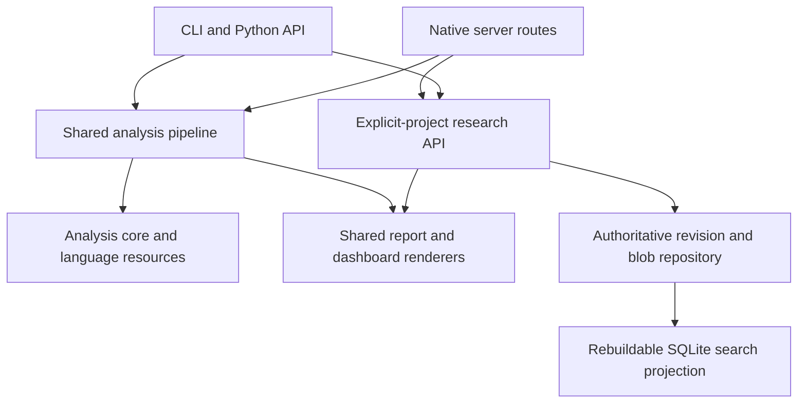

# Architecture and integration boundaries

This document records shared responsibilities and integration boundaries.
Product maturity, response schemas and research storage versions are independent.
[Usage](USAGE.md) owns workflows; [automation](AGENTS.md) owns request and result
contracts; [research usage](research/USAGE.md) describes implemented archive behavior.
The [research RFC](research/README.md) includes unimplemented proposals.

`lixity.research` owns explicit-project captures, immutable snapshots, citations,
authored records and a rebuildable SQLite/FTS5 index. It does not import into
`lixity.pipeline`. Source analysis may use the shared engine and UI, but research
sources never join manuscript baselines automatically.

The [local data model](research/DATA_MODEL.md) diagrams the current reference
chain and publication process, and separates authoritative archive data from
the disposable search database. Historical interchange proposals do not define
the accepted local schema.

## Layers

| Layer | Responsibility | Must not own |
| --- | --- | --- |
| Language resources | Lexicons, patterns, labels, formula coefficients | Project-specific character lists or file paths |
| Analysis core | Metrics, paragraph profiles, uncertainty and statistical diagnostics | HTTP sessions, exports or UI state |
| `lixity.pipeline` | Resolve document language; assemble one analysis result | Implicit file reads or mutable global project state |
| CLI / `lixity.api` | Input/output contracts and threshold resolution | Duplicate analysis algorithms |
| UI | Render results using shared components and bundled assets | Recompute statistical decisions in JavaScript |
| `publication` / `pdf_export` | Validate entered publication data; compose shared PDF bytes | Infer legal identities, establish rights or write output files |
| `lixity.server` | Loopback transport, request guards, one shared dashboard assembly and selected-workspace transitions | A second renderer, a second analysis path or CLI/service lifecycles |
| `config` / `io` / `workspace` | Explicit project metadata, atomic byte I/O and manuscript discovery | Implicit identity/publication defaults or duplicate writers |
| `lixity.service` | Managed local process lifecycle (start/stop/restart/status) | Adopting externally managed units |
| Project adapters | Manuscript access, publication actions and local services | Copies of the engine |

`lixity.math_core` is the single mathematical vocabulary of the analysis core
(robust scale, significance z, normal tail, ratio/share/density totalization,
plug-in standard errors and published effect bands). Heuristics import it
instead of restating formulas; `style_fingerprint` re-exports the historical
names for callers.

The server separates transport (`runtime`, `_base`, `handler`), selected-workspace
state (`_state`), dashboard assembly (`views`) and domain route groups. Registered
route tables drive dispatch and discovery. Handlers validate and shape requests,
then delegate to the shared pipeline or `research.api`; they do not implement a
second renderer, analysis algorithm or archive writer.

Arrows show delegation or derivation, not a second analysis or storage path.
Research measurements use the same core only when explicitly requested; retained
source passages do not enter manuscript baselines. The browser owns transient
selection/display state, while guarded routes delegate durable writes to the
research API and repository.

One process has one selected workspace. Opening selects an existing project;
importing browser bytes creates one at an explicit destination. A browser filename
does not identify its original parent directory. An archive may open without a
manuscript. `workspace.resolve_project_target` resolves explicit selectors; API
research calls stay explicitly scoped. An occupied port fails startup. Since
v0.7.2, an invalid explicit `serve` selector fails before binding or selecting a
workspace. Valid directories without a unique manuscript can still open as empty
workspaces; `--no-project` explicitly starts without project selection.

`DocumentAnalysis` reuses corpus/chapter measurements for the fingerprint and
renderers. Narrower profile/fingerprint requests use the same pipeline. Dashboard
refresh validates manuscript bytes before serving cached measurements and rebuilds
when a readable changed source can be rendered. **Since v0.7.2:**
`RefreshOutcome` distinguishes unchanged/rebuilt, missing, unreadable and failed
refreshes. Missing/unreadable sources and config/render failures retain the last
successful HTML, metadata and source digest, with a per-response localized
freshness notice and a plain GET retry route. They do not relabel old measurements
with an unvalidated source identity. Recovery after a failed rebuild requires a
successful rebuild; recovery from a read outage can validate identical bytes
without recomputing. Explicit analyze/rebuild requests fail when the selected
source is unavailable. No versioned JSON fields or automatic configuration
watcher are added. Research overviews reuse one validated archive snapshot without
a persistent cache.

Current main reduces read cost within these existing operation boundaries.
Revision reads perform one complete containment walk immediately before bounded
I/O, followed by checksum and schema validation; public checked-path helpers
retain their safety contract. A small initial read avoids allocating the entire
32 MiB object ceiling for tiny JSON records. Larger seekable objects rewind
and use the original bounded read, avoiding a second payload-sized allocation;
nonseekable buffered streams retain bounded continuation. Timestamp parsing uses the native ISO calendar
parser for strict ASCII records, with guards for older accepted syntax. Full
snapshots still read and verify every accepted revision; no filesystem metadata
shortcut or cross-request parsed-record cache replaces those checks.

Citation batches derive active source-version heads once per verified snapshot
read, while each citation still verifies its pinned passage against retained
bytes. The comparison head never changes the cited version. History selects one
identity's contiguous accepted revisions and serializes change metadata without
copying dossier bodies. These projections are local to the call. The existing
lifecycle index keeps citation availability separate from factual accuracy.

Plain inline prose uses the existing markup cleaner directly when it contains
none of the escape, code or link openers. Syntax-bearing input retains the same
delimiter recognizer; the optimization changes neither the counting projection
nor exact source/display identities. Language profiles own word boundaries;
first-person matching normalizes apostrophe variants only in its comparison key,
leaving source text and starter-diversity tokens intact.

Research backup export and restoration share complete manifest-chain validation
in `research.archive`: bounded, checksum-verified objects must satisfy the
versioned manifest model, project identity, consecutive generations and root
termination. Invalid or incomplete history fails before output replacement or
restored-store publication. Inventory paths use the repository's existing
containment/symlink boundary, which also rejects parent components. This is
validation of the existing format, with no schema migration or alternate store.

**Since v0.7.3:** export owns the repository writer lock from
accepted-snapshot selection until its compressed candidate is self-contained.
This serializes commits and purge against the copied records/blobs. Root pointers
come from that snapshot; stored object content addresses and the bytes actually
copied must agree. The candidate is flushed before output replacement. A failure
before replacement preserves the previous backup; a later directory-sync failure
reports published output with uncertain durability. Restore validates envelope
shape, identifiers, digests and optional sizes before inventory reads, rejecting
duplicate members. Export format and canonical records remain unchanged.

## Manual manuscript associations

`research.manuscript` owns `ManuscriptClaimLink`, separate from imported source
evidence. Explicitly permitted quote retention pins a reviewed claim revision and
an immutable `paragraph-profile-text/1` anchor: project-relative path, source and
displayed-paragraph hashes, source lines and Unicode-codepoint offsets. The first
opted-in save requires record/manifest v7; reads never upgrade existing archives.
Historical v3.0.1 supports only v1–v6 despite its higher product number.

`pipeline.paragraph_identity` supplies the same identity to rendering and research.
Current-main anchor reads use the same displayed-paragraph projection as the
full profiler, without running linguistic counters or chapter aggregation.
The parser's chapter membership, inline display text, line spans and hashes
remain shared. Literal occurrence matching counts overlapping occurrences;
an ambiguous quotation is rejected rather than pinned to its first match.
`FileUtils.read_source_snapshot` binds raw bytes and decoded text; creation checks
source containment and bytes again before publication. Review uses the validated
archive snapshot and existing pipeline paragraphs. It preserves anchors and claim
pins, distinguishes missing from unreadable sources, and leaves ambiguous or moved
candidates for explicit review. It does not infer factual support.

Manuscript routes validate both selected manuscript and archive contexts before
calling the API. Saved-quote counts join explicit associations from one coherent
snapshot, disclose differing revision pins and do not establish manuscript use or
nonuse. Rendering preserves exact resolved quote spans and complete text search.

**Since v0.7.2:** relation navigation opens an association's pinned
claim revision, then its explicit pinned dossier reference. Scoped Review routes
join saved manuscript associations by those references, independently of the
dossier's derived current-claim list. Only existing exact anchor matches offer
passage jumps. The document origin/return context is ephemeral and guarded by the
current project/source/research context. Its compact work thread displays the
original chapter/line span and the last accepted viewed record identity and saved
revision, distinguishing an explicitly pinned version from a current or viewed
version. Return or a changed project/source/research context clears the thread;
no archive/backend schema is introduced.
Native selection uses ephemeral paragraph-local UTF-16 offsets and direction,
rebuilt against exact paragraph text on return so annotation repaint cannot
mutate a saved live Range. Saved archive offsets remain Unicode codepoints. Existing citation
envelopes retain source version, passage identity, hashes and offsets. Ordinary
source reading is not relabelled as the historical cited version. Retained quote
cards do not provide a full historical-source reader. Dossier readers group
authored notes, derived current-linked claims and citations, while global claims
and decisions remain available through their existing routes.

Ordinary authored CLI updates require a reviewed revision, change kind and reason;
when the archive snapshot is omitted, the backend's current read guards the same
strict writer. Changed associations require reviewed pins; races fail without retry.
`research.revisions` shares candidate validation across exact writes,
dry runs and batch preparation. Prospective comparison uses one snapshot for both
values; historical comparison resolves saved revisions without repinning. Section
reconciliation changes only the selected body subtree while ordinary field changes
use the same candidate. HTTP, images, acknowledgements and batches retain their
explicit guards. No preview establishes that a future write will succeed.

Since v0.7.2, normalized authored content equality is decided in
`research.revisions` after complete metadata, field and association validation.
An unchanged candidate returns the exact prior record, preserving its revision,
encoding and historical pins. Mixed batches publish changed members only; invalid
operations reject the entire batch. `research.repository` retains the writer
lock and concurrent HEAD check even for an empty commit, then returns without
rewriting retained bytes, HEAD or the disposable SQLite index. Immutable JSON
records, blobs, manifests and HEAD remain authoritative; no archive migration or
second store is introduced. Decision acknowledgements remain append-only events,
not authored-content no-ops.

`research.dossier_edit` encodes an explicit leading JSON comment and
the exact body as a Markdown draft. It validates identity/base and delegates to
existing three-way preparation; ready changes become ordinary batch operations.
Versioned reviewed packets bind project and snapshot through the shared backend.
The archive stays authoritative: there is no parallel store, watcher or two-way
sync. Exports use exclusive publication outside the archive/internal directory.
The canonical project writer lock remains the only mutex; diagnostic error types
distinguish contention, read-only/permission failures and other I/O errors.

### Passage research presentation

**Since v0.7.3:** `manuscript-links.js` selects exact saved
associations with the same resolved lines, paragraph hash, codepoint span and
quotation matcher used for manuscript marks. Explicit paragraph activation
composes existing GETs for pinned claim/dossier records and current dossier
decision reviews; it adds no endpoint or archive schema. The first five
associations and first five decisions per displayed dossier have explicit totals.
Current dossier context is distinct from the historical claim/dossier pins.

This composition stays in the existing link closure, with its root, project,
source and review-generation guards. Duplicate exact reads coalesce within an
activation; inconsistent snapshot envelopes fail instead of mixing versions.
`LixityWorkbench` owns the `research` context tool alongside values and dossier,
and `LixityReadingThread` owns the exact passage return. Opening a context neither
replaces the prose node nor saves records. Unlinked text, an uninitialized archive,
unavailable data and failed/stale reads have distinct states. The public demo
uses the same static website projection and read-only profile as exported
project reading copies.

### Static reading websites

`site_export.prepare_site` reads an explicit project and assembles a bounded
`SiteBundle`. Review mode uses the shared pipeline and `render_analysis`, with
the native UI's read-only capabilities. Its research data is a separate opt-in
projection of one verified snapshot; original source files and full extraction
text require another opt-in. Snapshot-scoped native response helpers avoid
repeatedly loading the archive. No global cross-request archive cache or relaxed
corruption check is involved.

Reader and companion modes resolve a validated root `site_publications` profile
against that snapshot. They select current or explicitly pinned dossier versions,
unique heading subtrees, public titles and chapter release gates before rendering.
They never serialize native Research responses or calculate manuscript analysis.
Whole-dossier citations and geography require explicit profile fields; images and
source bytes require a separate, one-export choice. Reverse associations, internal
claims, decisions and history are not inferred publication selections.

An export cap removes later entries and dependency assets before serialization;
reader mode additionally truncates canonical manuscript chapters and omits markers,
front matter and appendices. Companion mode passes no manuscript blocks to the
shared reading shell. Both reuse the literal ReaderBlock renderer and native
Markdown, diagram, image and geographic components. Browser-local progress is an
explicit reading aid, scoped to publication identity, source hash and cap. It does
not establish access rights: included later bytes remain inspectable. Invalid or
unavailable storage starts at chapter zero, and preview never advances progress.

The embedded `lixity-read-only-site-data/1` response table contains enumerated
prepared reads. The first-loaded static transport returns these reads without
a server, rejects mutation and unknown requests, and never falls back to a
host's `/api`. Shared UI owners suppress unsupported editing and administrative
actions. Retained media uses explicit bundled-resource mappings; maps start
with offline geometry, without external tiles or implicit analytics requests.
Browser-local reading preferences remain available.

`export_site` publishes a fresh directory only after complete assembly; existing
destinations are rejected. The native `site-export` route downloads an in-memory
ZIP, bound to the current manuscript metadata token and rechecked selection.
It does not publish a site or create files in the source project. The website
manifest inventories scope, source identities and file digests. It is a public
projection contract, separate from archive entity/manifest versions; it does
not supply accounts, encryption, copy prevention or a restorable backup. See
[the data model](research/DATA_MODEL.md#reading-website-projection) and
[the sharing workflow](USAGE.md#export-a-reading-website).

## Configuration and multiple projects

Explicit root settings own author identity, publication, reading-site profiles,
chapter registers and project-local character profiles; user/ancestor defaults cannot supply them.
The optional root `manuscript` setting follows the same project-only boundary.
`config.read_explicit_project_config` reuses the existing TOML parser but reads
only root pyproject/lixity files and promotes failed reads to errors.
The native view, PDF composer and website exporter all use this selected root,
including when the manuscript is in a subdirectory with another configuration.
`workspace.configured_manuscript` owns contained relative-path resolution without
reading source bytes. `discover` applies explicit → configured → conventional
selection and validates configured regular files. The read-only Research CLI
uses the same path owner after validating its archive, then preserves its domain
review of missing/unreadable source bytes. Python text-analysis APIs stay explicit.

**Since v0.7.3:** `workspace.resolve_manuscript_target` selects
one root/source pair before analysis configuration is loaded. Command-level
`--project` and root-configured omission use strict root-local settings; legacy
explicit files and conventional scenes/build discovery without `--project`
retain their existing merge. The Research CLI normalizes omitted manuscript
input after validating its archive. These selectors do not change a running server's project or any JSON
result encoding.
Output scene filters run after complete measurement; explicitly planned IDs remain
separate from measured rows and never influence descriptive baselines.

`project_identity` compares only bounded
manuscript metadata syntax, without rewriting text or affecting measurements.
`PublicationSettings`/`PUBLICATION_FIELDS` supply field validation to configuration,
settings and PDF composition. `pdf_export.compose_pdf` composes bytes for CLI and
HTTP; callers own output writes. Front matter uses entered data, and syntax checks
do not establish publication compliance.

Since v0.7.0, manuscript PDFs use one presentation projection
(`manuscript_document`) of the shared Markdown blocks. It retains structure and readable
inline styles rather than using the statistical prose filter. Book, editorial
and submission layouts share block placement and the same PDF document engine;
the analysis report retains its metric tables. Editorial geometry reuses
`BookLayoutConfig`, which also remains available to embedding adapters.

`config.prepare_project_settings` validates one settings candidate while
preserving unrelated TOML values. The route renders that candidate,
commits through `PreparedProjectSettings`, then publishes session/cache state.
Decode, validation, render or replacement failures publish none of the candidate.
Selected-context tokens bind source/root and both root config digests. Publication/
register saves and manuscript PDF downloads reject stale required context. Config
reads accept regular nonsymlink files and verify the opened descriptor's identity.
The optimistic commit guard checks observed identity and bytes immediately before
replacement; it is neither an external-editor lock nor a manuscript content pin.

**Since v0.6.0:** explicitly requested language/threshold defaults
reuse this transaction and its project token. Session-only Apply remains the
default. Installed configuration metadata derives publication bounds from the
same model/field registry used by rendering and validation.

`FileUtils.atomic_write_bytes_if_changed` is the shared text/binary writer:
same-directory staging, complete write, flush, mode preservation, fsync and atomic
replacement. Unchanged bytes skip replacement and its optional guard. Errors
propagate, temporary stages are cleaned, and no direct-overwrite fallback exists.
`Workspace.publish` preserves distinct same-minute artifacts, recognizes historical
archive names and prepares the stable artifact before replacement. Failure stops
before archive rotation.

`load_project_config(path)` searches from its supplied path and merges supported
project/user settings. Pass the intended mapping to `resolve_document_config` and
`resolve_thresholds`; explicit options win. An empty mapping selects code defaults
without discovery. The facade's `profile`, `fingerprint`/`passport` and `dashboard`
accept that mapping; `None` retains threshold discovery for compatibility.
Use `analyze_document(text, config, thresholds)` when several outputs need the same
measurements. Project adapters own their characters, motifs, paths and artifacts.

Shared owners preserve failure signals across interfaces: configuration discovery
reports metadata/read failures and malformed TOML sections through its existing
warning channel; the guarded `FileUtils` source reader also serves dialogue,
pacing, motifs and showing CLI commands. Low-level structure reports reuse the
English `CorpusConfig` default, while explicit `auto` retains detection.
`StyleFingerprint.from_metrics` rejects non-finite feature values and invalid
standard errors before scoring; documented unavailable-value conventions remain
separate. Research claim-confidence and evidence-relation normalization belongs
to `research.api`; supplied invalid HTTP values fail rather than receiving an
omission default.

Current main computes chapter-versus-rest Cliff effects from sorted finite tie
groups in O(C log C) per feature rather than rebuilding and comparing C separate
rest-of-manuscript lists. Integer wins/losses and the C−1 denominator preserve
exact effect values, including ties and signed zero. This changes computation
cost rather than the statistical interpretation, reference scope or JSON schema.
Sn likewise selects each high inner median by binary partition of two monotone
distance sequences around a sorted observation, then takes the low outer median.
Finite observations use O(C log C) work and O(C) memory with the same Gaussian
scaling and floating-point distances. Direct nonfinite inputs retain the legacy
exhaustive behavior; production feature validation still rejects nonfinite data.

The shared Markdown parser defines measurement prose and chapter numbering.
Inline counting retains visible link labels and excludes link targets,
images and code. It stays separate from displayed paragraph text and quote identity;
zero-token chapters retain their source numbering. `characters.CharacterProfile`
owns literal alias/declared-POV validation and its discoverable schema; one resolver
serves CLI, API and dashboard. Declared POV stays separate from lexical mention counts.
Paragraph profiles cover body/list blocks; legacy whitespace counts remain
separate. Token regex flags are preserved, while linguistic cue patterns have a
case-insensitive compiler. [Methods](METHODS.md) defines exact scopes and numerical
conventions. Scene groups compare only explicitly assigned manuscript observations.

Research revision preparation, section edits and grouped saves reuse strict
validation and one repository commit. Section reads, preparation and image placement
share the code-aware ATX heading parser. Review follows recorded links and revision
pins, without inferring contradictions. Images reuse immutable source/version/blob
records, never fabricated text passages; textual analysis rejects them. Attachment
and dossier revision publish atomically. Purge retains identity for honest unavailable
placeholders, not image bytes. Shared limits come from `research.limits`.

## Presentation and trust boundaries

The dashboard is a self-contained HTML file. Python bundles CSS and scripts; no
CDN or frontend build step is required. Chapter-title tooltips use text nodes,
not executable markup. Rendering and point picking share projected coordinates. Animation
is scheduled only while rotation is enabled and the page is visible. The live
shell applies a per-response script nonce and default-deny CSP; bundled components
require no `unsafe-eval`.

Research media reuse bundled PhotoSwipe 5.4.4 for retained images and
generated diagrams. Mermaid tiny 12.2.0 owns diagram syntax/layout and initializes
only when a diagram first becomes visible; restrictions disable resource loading,
click actions and configuration directives, with source retained on failure.
Leaflet 1.9.4 provides geographic vectors. **Since v0.7.2:** visible
maps load OpenStreetMap tiles by default; users can turn off the background or
choose the offline sketch. Tile requests stop outside the visible map/project
context. Tiles reveal the client IP and viewed area;
attached historical images remain independent evidence, not calibrated basemaps.

### Logging

`src/lixity/log.py` is the one logging entry point. Modules log through
`get_logger()` under the `lixity` tree; the CLI keeps stdout as its result
channel and sends diagnostics through logging. Lines use a single UTC format
(`YYYY-MM-DD HH:MM:SS UTC LEVEL lixity.<area> message`) with standard levels,
resolved from an explicit argument, else `LIXITY_LOG_LEVEL`, else DEBUG while
`LIXITY_DEBUG`/`--debug` is active, else INFO.

The managed service appends the child's stderr to `service-PORT.log`;
`rotate_service_log()` bounds that file at service start (one writer per file,
rotated to `.1`–`.3`). The stderr handler follows `sys.stderr` at emit time,
so `redirect_stderr`, the captured service descriptor and tests all see the
same stream. Request logs never contain query strings — context tokens and
selectors travel there — and log records never contain manuscript text.

`ui/dimensions.py` renders a semantic score table from the same measured points
as the canvas. It keeps chapter titles, available scores and native chapter links
usable without JavaScript; native rotation/zoom controls call the same projection
renderer. Unmeasured chapters and absent axes are omitted.

### Visual consistency and evidence

The local dashboard and Pages share `ui/assets/design-tokens.css`; components and
surface styles own actual color, typography, spacing and control rules. Heatmap
text selects contrast from cell luminance. Native controls, visible boundaries,
focus outlines and non-color cues support navigation. [WCAG contrast](https://www.w3.org/WAI/WCAG22/Understanding/contrast-minimum.html),
[target size](https://www.w3.org/WAI/WCAG22/Understanding/target-size-minimum.html)
and [text-spacing overrides](https://www.w3.org/WAI/WCAG22/Understanding/text-spacing.html)
inform the checks; defaults are product choices, not universal typographic optima.
Exact tokens and dimensions belong to CSS and executable checks rather than a
second prose specification.

**Since v0.7.3:** prose heading roles cover all six Markdown
levels; subordinate headings do not fall through to small browser defaults.
Fenced code inherits its block's size instead of compounding inline-code scaling.
Shared controls inherit the interface font; canvas labels resolve the same UI and
technical font tokens through the existing style probe. Serif manuscript text,
system interface text and monospace technical notation remain distinct roles.
[Fluent typography guidance](https://fluent2.microsoft.design/typography) informs
this role-based hierarchy. [Wallace et al. (2022)](https://research.adobe.com/publication/towards-individuated-reading-experiences-different-fonts-increase-reading-speed-for-different-individuals/)
found individual differences in font-related reading performance; that does not
establish one best font or a reading-speed benefit for Lixity.

The manuscript is the primary workspace. Analysis supports passage selection
and interpretation; retained evidence and authored dossiers provide context.
These are connected views over the same project, not independent products.

**Since v0.7.2:** interactive dashboards use a fixed project sidebar
on wide screens, with manuscript/analysis first, research second and settings
third. Narrow screens keep a horizontal switcher. Tab orientation and keyboard
navigation change together; the sidebar scrolls independently if its controls
exceed the viewport. Plain exported reports retain their document layout.
Both presentations use the same renderer, labels, data and action handlers.
The desktop navigation uses the shared `ctl` toggle. Companion reading applies a
temporary collapse override only in the analysis view; closing restores the manual
choice. Responsive changes keep the mobile switcher available. Exact manuscript
return actions reuse the existing paragraph navigation and the same anchor matcher
as inline association marks, with a current project/source context check on click.

**Since v0.7.3:** the native shell renders the product row,
primary destinations, project identity, project actions and secondary version/
license information in that DOM order. Navigation no longer depends on runtime
reparenting. App chrome uses interface typography; exported document headers keep
their existing presentation. The shared collapse owner hides project context and
actions while retaining product identity and all three destinations.

### Shared manuscript reader

**Since v0.7.2:** `ui/manuscript_reader.py` emits the shared command
surface. The interactive manuscript stays continuous while an **Analysis** toggle
exposes diagnostic presentation in place. Turning the layer on does not open a
dock or apply the navigation-collapse override. Its absolute gutter marker does
not consume prose width or change line wrapping. The constant accessible name,
pressed state, switch indicator and visible On/Off text distinguish that choice
from the active context tool; the state label reserves enough width for either
localized value. Dense comparisons use an overview with a return to the preserved
passage and prior overlay choice. There is one
canonical manuscript DOM; changing tools or analysis visibility does not replace
its source text or create a hidden duplicate reading tree. Loaded-project chrome
uses a class emitted by the renderer; it does not use a body-level `:has` query
over the mutable prose tree, which would broaden annotation/style invalidation.
When the leading authored level-one heading exactly matches the project title,
the reading surface suppresses only the generated sidebar title. The original
source heading stays intact, and Project, Research and the analysis overview keep
the generated project context. The existing workbench owner publishes the view
attribute; no prose observer or second navigation state is introduced.

Exact analysis evidence in v0.7.3 is a separate optional projection, collected
inside the existing paragraph-profile pass. `ParagraphMatcher` owns the same
resolved counters used for profiles and literal evidence; the UI does not run a
parallel linguistic detector. `DocumentAnalysis.evidence` is not part of default
analysis/profile JSON. The renderer appends its paragraph-identity envelope to
existing lazy paragraph data. Native CSS Highlight ranges preserve the prose DOM;
a single Preact leaf owns the explanation card. Only visible paragraph generations
are prepared, with explicit codepoint-to-UTF-16 conversion and hash validation.
Search/research mark changes invalidate derived ranges, not source identities.
Analysis visibility, metric changes and workspace changes cancel stale cards and
marks. Unsupported or unprovable mappings remain explicit unavailable states.
Since v0.7.4, the paragraph menu opens one existing passage inspector. Its
measurement action captures the source point and uses the evidence owner; its
research action delegates to the existing explicit passage association reader.
An identical accepted manuscript-review report in the same source/project
context retains its list nodes, preserving native dialog focus-return targets.
A changed report or list filter still renders; errors clear the accepted report.
The presentation keeps computed counts and authored research separate without
a new context state or transport contract. The floating card uses native counts
and the existing paragraph comparison; it never parses localized numeric text.

The existing reader preferences also retain the selected metric and marking
choice. First explicit Analysis On defaults to `asl` only without a saved choice;
the native disclosure beside the switch contains the single existing selector
and marking checkbox. Explicit paragraph inspection can enable Analysis through
the workbench owner while preserving disabled paint. Missing cryptographic
verification is distinguished from a mismatching paragraph identity.

The existing paragraph menu snapshots a native pointer caret as a transient
UTF-16 paragraph offset and evidence identity. After normal source verification,
inspection selects the existing counted span containing that point; it does not
run another detector or guess a quotation after reflow. Ellipsis and keyboard
actions without a literal pointer point keep the first-match entry. A transient
opening token cancels superseded requests across the reader's layout wait while
allowing its own position restoration; explicit pointer, wheel, scroll-key and
view/layer changes take precedence.

`manuscript_document.manuscript_blocks` supplies source-ordered semantic blocks
with absolute inclusive line spans, before PDF-specific title suppression and
endnote movement. Its existing `manuscript_sections` adapter retains the strict
PDF inline/TeX contract. `ui.manuscript_document.reader_blocks` joins source blocks
to existing `ParagraphProfile` owners by interval, preserving each original
`p-N`, exact text, hash and source span. One profile can cover several presentation
list items; that profile remains a single owner. Partial overlaps retain uncovered
source lines literally, while overlapping profile owners fail explicitly.

Source-holding API, CLI, native and retained-source render paths pass the optional
presentation to the same dashboard renderer. Profile-only callers retain their
existing fallback. Preface, empty chapters, supported headings/quotes/code/dividers/
notes and the analysis-excluded appendix remain readable without acquiring
statistical coverage. Unprofiled blocks have no invented values or claim-writing
actions. Pipe tables and unsupported inline syntax stay literal; HTML/TeX-looking
text is escaped, and manuscript images are not fetched automatically. In
particular, rich link/footnote normalization cannot change the existing exact
paragraph-text quotation contract. This is a bounded source presentation, not
a new editor, general Markdown engine or analysis JSON schema.

The reader uses native buttons, selects and disclosures with shared `ctl` styles
and the seven-language label pack. Size, width, spacing and split preferences live
in browser storage; denied or malformed storage falls back to usable defaults.
Focus mode is reversible and temporary. Layout changes capture the first visible
source block and restore its viewport position after reflow where possible, rather
than persisting a second text offset or editing manuscript content.

Paragraph ellipsis buttons, pointer context menus and keyboard context-menu
shortcuts share the same action builder. A valid single-paragraph selection
offers a small toolbar. Marker and claim actions delegate to the established
handlers, including their explicit save, capability and retention checks; no
parallel write API is introduced. Values reuse the paragraph's measured markup
in the closable Passage values inspector, alongside chapter/source-line context
and the existing saved-research route when supported. Opening Values does not
force the global Analysis layer on. Explicit Values/dossier
controls replace the active dock content while retaining each tool's selection.
Closing the dock does not hide the diagnostic layer; turning Analysis Off
preserves an explicitly open Values inspector or dossier. Overview return
restores the previous layer visibility and context tool. On narrow screens, an explicit passage
tool request stores its own origin and reveals the stacked dock heading; close
or Escape restores the requesting passage and focus. That intentional destination
scroll is not overwritten by ordinary reading-anchor restoration. Desktop tools
keep the adjacent layout. Menus expose
arrow/Home/End navigation and restore trigger focus on Escape.
Association refreshes skip unchanged annotation DOM and preserve native selection
endpoints when marks change. Automatic review uses the existing research-status
read before requesting archive records; context-bound pending reads are coalesced
and invalidated on project changes.

**Since v0.7.3:** the existing reading thread owns one nearest
dossier departure above an optional manuscript origin. An accepted dossier render
provides its project/research context, saved revision and a current-render guard;
departure captures the requesting control, tab and scroll ancestors. Return
restores that existing DOM and exact offsets after display work settles. It does
not repin records or reload a dossier. Replaced roots and changed contexts
invalidate the return. The same control moves from the desktop sidebar into the
mobile page flow; its observed height offsets other sticky controls.

Reader layout restoration has one revision-guarded owner for tool changes. Until
the opening frame commits, later arrangements reuse the stable reading anchor;
once it commits, deliberate scrolling becomes the next origin. Reading settings
observe their native disclosure state before rendering so initial placement does
not depend on the later native `toggle` event.

**Since v0.7.3:** the existing dock measures its available
desktop scrollport against the viewport, sticky return thread and containing
grid's lower boundary. Dossier return settles this geometry at the restored
document position before restoring inner scroll offsets, avoiding premature
clamping. Temporary overview/focus suspension preserves accepted or stale/retry
presentation; expired asynchronous reads cannot revive it.

Reading feedback does not own layout or navigation. Persistent Analysis/local
Values gutters use separate paint from the temporary arrival cue; its expiry
does not reset the persistent marker's opacity. Prose avoids a second arrival
outline. Interrupted context reveals continue from rendered opacity. The Analysis
toggle's local selected-state recipe preserves text contrast during transitions;
reduced motion retains static state and cancels active reveals.

The shared jump helper reveals a real destination, accounts for sticky controls
in its own scroll area and accepts start, center or nearest alignment. Arrival
feedback observes the destination and its scrolling ancestors until stable;
new jumps cancel pending and visible obsolete cues. Exact context restoration
uses the observer without realigning the restored position. Reduced motion is
read at navigation time. [W3C C43](https://www.w3.org/WAI/WCAG22/Techniques/css/C43)
and [focus-obscuration guidance](https://www.w3.org/WAI/WCAG22/Techniques/failures/F110.html)
inform clearance checks, including short viewports and wrapped controls.

Workspace changes remember their existing `#view-…` fragment through
`replaceState`, without adding history entries. Fragment-driven navigation keeps
its more precise destination. The hash handler ignores events
whose destination no longer matches the current URL, so an older queued passage
jump cannot reverse a newer view choice. A later genuine fragment still navigates.

Action explanations reuse `tooltips.js`, localized label packs and native
controls. Hover and keyboard focus expose supplemental text; the tooltip does
not contain actions or take focus. Actual shortcut bindings also have a visible
reference under Reading settings. Important workflow information stays in labels,
state and empty-state actions. Placement clears the complete owning toolbar,
including wrapped adjacent controls. Action activation dismisses help until fresh
pointer/focus intent; vendor-owned PhotoSwipe controls retain their own titles
and keyboard behavior. The [WAI-ARIA tooltip pattern](https://www.w3.org/WAI/ARIA/apg/patterns/tooltip/)
and [WCAG hover/focus guidance](https://www.w3.org/WAI/WCAG22/Understanding/content-on-hover-or-focus)
inform dismissibility, hover persistence and accessible descriptions. These are
targeted checks, not a claim of application-wide accessibility conformance.

The companion's desktop `separator` supports pointer dragging and keyboard
adjustment over a bounded manuscript-width share. The split is a local display
preference, hidden when readers stack on narrow screens. Images, geographic maps
and style-space retain their existing PhotoSwipe, Leaflet and canvas interactions;
manuscript dragging continues to select text. The reader does not create a
free-panning manuscript canvas or a manuscript editor.

The interface follows a reading-first hierarchy: a passage or visual comes
before its detailed measurements; advanced explanations stay near the control
that needs them. Shared design tokens own the paper-toned light surfaces, ink,
muted text, dividers and action accent across the native UI and Pages; the site
does not introduce a separate palette. Existing serif manuscript/chapter type
and system interface type distinguish prose from controls. Spacing and selective
dividers separate supporting content; warnings, editable fields, selection and
dialog boundaries retain their distinct roles. Reader composition and companion
spacing remain in their existing stylesheet owners, without a second display
state or altered reading preferences.

**Since v0.7.3:** the overview wraps secondary KPIs in the native
`analysis-measurements` disclosure, initially collapsed for interactive workspaces
and expanded for standalone reports. Review routes, section navigation and flags
remain outside it. Scene detail disclosures share a second reversible catalogue;
comparison-row links target a scene's existing measurement table. The shared
`scrollAndFlash` helper reveals disclosure ancestors before measuring the target.
Native disclosure state survives view changes without a new preference store.
Bounded flags/scene regions support keyboard scrolling, and wide comparisons
retain chapter, character or scene identity while scrolling horizontally.

These presentation changes keep dialogue chapters in manuscript order,
including measured zeros, and label pacing ASL units, bar scaling and the existing
Hook heuristic. The chapter matrix renders `0` for an available comparison with
no cutoff crossings and `–` for unavailable comparisons. Its `ChapterProfile`
values still cover profiled body paragraphs/lists; fingerprint measurements use
`CorpusMetrics`, which also includes blockquotes. The new coverage note explains
that existing difference without changing analysis coverage, scores or public JSON contracts.
Section tracking ignores hidden targets and handles the final section at the
page boundary. A scene-table drill focuses its revealed measurement region.
Overview-to-manuscript drills transfer focus when their overview source becomes
hidden; preserved passage/context returns retain their established owner.

Diagram frames follow content width within the reader, and
wide diagrams retain their label scale in a scrollable viewport. Style-space
navigation groups paired actions at responsive widths. Pages uses the shared
tokens and stylesheet, with direct demo and installation entry points and
screenshots of the same native components rather than a parallel product UI.

The public landing page demonstrates the product and routes to the demo or
installation. README owns purpose, first commands and the documentation/repository
map; guides own complete workflows and references own detailed contracts. The
demo retains the native workspace with a compact return link, rather than a
second site navigation inside the application. Screenshot framing follows real
viewports or complete task boundaries; camera helpers do not override native
dialog scrolling or hide content to make an image fit.

The shell groups New/Open, guidance and PDF export in one native **Project
actions** disclosure. It starts closed with a loaded manuscript and open in an
empty workspace, while the three destinations remain directly available.
Disclosure visibility stays in the DOM; backend project state and capabilities
remain separate. Modal openers stay visible behind their dialog for focus return.

Native `details` elements own research composer visibility. Their field DOM stays
mounted across collapse and tab switches, preserving in-memory drafts without
introducing another state store. Shared disclosure helpers reveal ancestors for
contextual navigation and collapse the innermost level with focus restoration.
The companion delegates nested disclosure Escape handling before closing itself.
The shared component stylesheet also supplies disclosure affordances to Pages;
reduced-motion preferences disable arrow transitions. Catalogue previews derive
plain text using the existing safe renderer, without changing API contracts.

Publication and execution are separate boundaries. The Pages demo follows the
reviewed source checkout; the release badge names the published package. A local
installation replaces package files, while the managed service must restart to
load them. Unreleased builds can have the same product version, so parity checks
compare relevant asset bytes rather than relying on a version string alone.

Desktop/mobile rendering, keyboard focus, text-spacing overrides, reduced motion
and both themes are checked with synthetic content. Automated checks and the
selected contrast audits do not constitute a complete accessibility certification
or replace testing with readers and assistive technologies.

### Interaction ownership and evidence

`workspace-state.js` owns the small display transition state exposed internally
as `LixityWorkbench`: workspace, document/overview, analysis visibility, active
context tool, focus arrangement and transient ownership. `project-ui.js`,
`manuscript-reader.js` and `workspace-reader.js` adapt those transitions to existing
DOM and navigation hooks. Domain records, pending saves, revision guards and
native disclosure fields keep their established owners. Preact mounts research
subtrees; it does not remount the manuscript or all form drafts.

Analysis visibility is independent of a selected dossier and never implicitly
selects an analysis dock. Overview entry suspends the dock and retains document
context and the prior analysis visibility; returning restores that choice, the
eligible tool and passage. Focus temporarily suppresses surrounding chrome; requesting another tool
restores that arrangement before applying the new intent. Workspace changes
close temporary menus/settings and suspend manuscript tools, so dormant views do
not consume the active workspace's keys or restore focus. Browser appearance
preferences are separate from ephemeral, project-bound passage/relation context.

`workspace-motion.js` consumes committed display state; it does not own visibility,
navigation, focus or data. Optional native opacity feedback covers at most eight
modestly sized visible elements, and a gutter marker identifies a passage return.
The reader is never cloned or snapshotted for a transition; neither prose/root
transforms nor grid/width animations are used. Semantic changes are immediate.
Feedback is enabled only without a reduced-motion preference; a live preference
change cancels running native effects and layer feedback while retaining the
static return marker. The preference handling is informed by W3C's
[Animation from Interactions](https://www.w3.org/WAI/WCAG22/Understanding/animation-from-interactions.html)
and [C39 reduced-motion technique](https://www.w3.org/WAI/WCAG22/Techniques/css/C39).

Research tab buttons and panels have explicit IDs, `aria-controls` and
`aria-labelledby`; the existing manual keyboard tab behavior remains shared.
Overflow controls reveal narrow-screen destinations without activating a view.
Mermaid retains its lazy visible-context renderer, with a visible localized
pending status as well as `aria-busy`; success/failure removes that pending state.

The following evidence informs interaction design; it does not establish an
optimal Lixity layout:

- [Sellen, Kurtenbach and Buxton (1992)](https://www.billbuxton.com/ModeErrorsHCI.pdf)
  studied mode feedback in restricted editor tasks. The transferable concern is
  visible state and predictable input, rather than a universal ban on modes.
- [McGrenere, Baecker and Booth (2002)](https://www.cs.ubc.ca/~joanna/papers/CHI2002_McGrenere.pdf)
  evaluated user-controlled simplification with 20 Word users. Simpler defaults
  need an accessible path to the full capability; customization has costs too.
- [Iqbal and Horvitz (2007)](https://www.erichorvitz.com/CHI_2007_Iqbal_Horvitz.pdf)
  observed task interruption and resumption. Preserving a passage, selection and
  return route is a design inference; their timings are not Lixity switching costs.
- [Heer and Robertson (2007)](https://idl.cs.washington.edu/files/2007-AnimatedTransitions-InfoVis.pdf)
  evaluated chart transitions, including unfavorable staging tradeoffs. Motion
  can explain continuity; it does not justify animating every panel or a fixed
  universal duration.
- [Apple's context-menu guidance](https://developer.apple.com/design/human-interface-guidelines/context-menus)
  treats contextual commands as additional access routes. Core operations need
  discoverable controls without relying on right-click or hover.
- [Scarr, Cockburn and Gutwin's spatial-memory review](https://hci.usask.ca/wp-content/cache/mendeley-file-cache/1723ad47-9012-384f-885d-e1c35c62d2ec.pdf)
  explains how stable control locations support learned retrieval. For Lixity,
  predictable navigation and return controls are a design inference; rearranging
  commands by recent use would need separate evidence.
- [GNOME's header-bar guidance](https://developer.gnome.org/hig/patterns/containers/header-bars.html)
  groups a few relevant commands through placement and spacing, while
  [Fluent's button guidance](https://fluent2.microsoft.design/components/web/react/core/button/usage)
  distinguishes primary from minor actions. These inform control hierarchy,
  rather than requiring a platform framework or an icon-only interface.
  [NN/G's signifier experiment](https://www.nngroup.com/articles/flat-ui-less-attention-cause-uncertainty/)
  found greater effort with weak clickability cues in targeted web-page tasks.
  Quiet styling must retain recognizable controls, labels and focus feedback;
  the study does not establish an optimal Lixity button style or performance gain.
- [Fluent's drawer guidance](https://fluent2.microsoft.design/components/web/react/core/drawer/usage)
  distinguishes adjacent context from intrusive overlays. Dense comparisons may
  need more space than a narrow inspector. [Carbon's color roles](https://www.carbondesignsystem.com/building-blocks/foundations/color/tokens)
  distinguish surfaces, selected states and semantic feedback; color must also
  have a [non-color cue](https://www.w3.org/WAI/WCAG22/Understanding/use-of-color.html).

Display preferences belong to the browser, not an additional server session
store. Selected-context tokens bind source/root/configuration; they establish
neither freshness nor authentication. Source digests, archive snapshots and
reviewed revisions provide separate checks. An exposed tool cannot bypass those
checks, and closing a view does not undo an already committed domain operation.

The canonical paragraph text and Unicode offsets remain authoritative for saved
research anchors. The richer source presentation joins different PDF/analysis
block boundaries explicitly by source intervals, never by text equality or list
position. UI work alone does not authorize an anchor migration, a new analytical
scope, automatic retention, or manuscript edits. Designs and local audit evidence
under review remain outside maintained product documentation.

Pages publishes `sitemap.xml` containing the canonical landing page and HTML
guides. Submit its public URL in Google Search Console; a sitemap aids discovery
but does not guarantee indexing. The project-path `robots.txt` is a policy
template, not the effective host-root crawler policy. Keep sitemap entries in
step with the HTML publication boundary and use real modification dates.

Optional mutation controls need a separate project server. The engine alone
does not start an HTTP service or send documents.
Shared `BookLayoutConfig` geometry and `inline_markdown_to_html` fragments remain
available to existing book adapters; they do not publish a book. Project author
and contact fields are explicit, with no personal contact default. The fragment
helper escapes attribute values and accepts HTTP(S), mailto, relative and fragment
links; executable schemes stay inert.
Server adapters must validate origins, hosts, request sizes and payloads,
restrict file/action access, and handle their own session lifecycle.

Since 2.0.0, `nda.py` is a pure five-field document generator.
`nda_templates.py` contains friendly text models in seven languages. The server
resolves the project language or an explicit document override, substitutes
literal values in the model or a confined UTF-8 template, and returns PDF/text
bytes. The browser previews inert text and downloads a Blob. The generator
has no recipient registry and creates no server files. Reviewed/signed documents
remain under the user's own storage policy.

Browser debug selection uses an explicit saved `1`/`0` before
window/server defaults. The server's response mixin supplies the shared UTC
writer for both request lines and error details. This separates a browser's
diagnostic preference from the server process's logging setting.

Project and research interface labels use the same language-profile resources
as the analysis dashboard. Python escapes the localized label dictionary into
an HTML attribute; JavaScript renders records as escaped text and applies
locale labels without changing stored identifiers or numerical results.
Seven interface languages do not imply equal linguistic validation: English
and German currently have the deepest coverage. Shared statistical routines
operate on language-dependent heuristic inputs.

### Component vocabulary and markup rules

`ui.components` and `assets/components.css` own shared panels, controls, fields,
status messages, badges and layout primitives. Views reuse them and the stable
[data hooks](AGENTS.md#34-dashboard-interaction-contract-for-embedding-and-ui-automation).
Visible strings come from the seven-language packs; mathematical identifiers stay
language-neutral. Prefer native elements and one primary action per form.

Local view tabs (style views, research and dialogs) share one component recipe:
a selected underline and surface distinguish navigation from primary actions.
Each tablist has an accessible name; project-dialog tabs explicitly name their
panels. The shared keyboard controller keeps one tab stop, follows orientation
and uses manual activation for research views that fetch data. Dialog switching
is scoped to the containing dialog so it cannot reset another editor.

Native `<dialog>` supplies modality, Escape and focus restoration. The shared
dialog frame keeps the title and close action above a scrolling form, uses
dynamic viewport height, and allows footer actions to wrap. Tabbed forms scroll
in their pane; direct forms scroll in the body. Avoid introducing competing
scroll containers or a custom focus trap. The [WAI dialog pattern](https://www.w3.org/WAI/ARIA/apg/patterns/dialog-modal/)
and [WCAG focus visibility](https://www.w3.org/WAI/WCAG22/Understanding/focus-not-obscured-minimum)
guide this behavior; targeted tests do not constitute a full accessibility audit.

Field groups, form rows, labels, disabled actions and feedback use the shared
component layer. Disabled buttons do not show enabled hover/pressed feedback.
Labels preserve localized casing. Research catalogues use separated rows within
their enclosing panel; nested evidence and detail surfaces retain their own
boundaries. Keep these view-specific layouts in `dashboard.css`.

Inline styles are reserved for measured/dynamic values. Layout and responsive
stacking belong in shared CSS; `tests/test_inline_styles.py` checks forbidden
spacing/typography patterns. New panels must remain usable at 320 px.

### Design system: one scale, one control language

CSS bundles in token → component → view order. The shared token and component
owners above apply to Pages and the dashboard; browser checks sample token use,
focus, contrast and text spacing.

### Stateful panels: the component layer (vendored Preact + HTM)

The Python renderer feeds both the live workspace and standalone exports.
Stateful research lists use vendored Preact/HTM through `LixityComponents`;
`vendor/README.md` owns the update procedure. Components own only their mounted
subtree, receive plain data and use shared localization helpers. Unmount before
imperative writes to their hosts; async card content belongs in the list model.
Stable class/data hooks remain part of component output. Domain actions, context
guards and pagination stay in panel scripts. Record keys preserve current details
or invalidate stale card state according to each renderer's refresh contract. Other panels migrate only
when their state requires it; a new component is not a second business-rule layer.

Since v0.7.3, claim evidence models also bind to the accepted archive digest,
project and context token. An identical record key alone is insufficient: links
and source availability can change independently of the claim. Only unchanged
bindings retain a loaded or pending panel; changed or absent bindings invalidate
its owner and reject late reads. Startup obtains the existing versioned claim
catalogue before exposing evidence actions, since the overview omits its digest.
These bindings remain ephemeral presentation state without changing the archive
contract.

## First-run journey (server contract)

Empty workspaces offer create/open/import actions. After a successful workspace
transition, a fresh render opens manuscript analysis when chapters exist, otherwise
research. Recent projects live only in browser storage. Standalone read-only
reports expose no project actions or welcome journey. Shared language packs own
the copy; the optional public-example link does not affect offline operation.
Project creation selects the new workspace only after configuration and requested
Research setup succeed. A setup failure retains created files and the previous
selection, reports the incomplete destination, and explains recovery through
**Open Project** after correcting its configuration or archive.

## Repository tooling

Developer tools in `scripts/` operate releases, documentation staging, public
examples and browser checks; they are not packaged engine behavior. Existing
platform startup scripts delegate to `lixity service`. [CONTRIBUTING.md](https://github.com/mfahsold/lixity/blob/main/CONTRIBUTING.md)
owns workflows and checks; `make help` lists entrypoints.

## Verification

Python checks cover domain behavior, orchestration, language resources, transport
and versioned contracts. Optional browser suites inspect synthetic desktop/mobile
workflows. Release verification compares packaged modules, UI assets and typing
metadata against source bytes. Adapter tests belong with their project; no private
manuscript is required. See [contributor checks](https://github.com/mfahsold/lixity/blob/main/CONTRIBUTING.md#development-setup).

## External research libraries (since v1.19.0)

Zotero owns acquisition, bibliographic editing, ordinary reading and notes.
Lixity owns retained evidence, authored project records and manuscript associations.
The optional `research.zotero` adapter captures selected evidence through the
[local HTTP API](https://www.zotero.org/support/dev/web_api/v3/local_api); it never
reads or writes Zotero's database. Keep the attachment selector and source-return
actions small. The retained passage reader serves evidence selection and review.
Captures preserve the version used by a claim independently of Zotero; they are
not a live library mirror. UI consolidation preserves source IDs, historical
citations and storage contracts.

The adapter adds no runtime dependency and bundles no Zotero application code.
Its additive RIS export preserves sources/citations and delegates import to
Zotero's supported workflow. Stable external attachment identities distinguish
repeated captures from refreshes; migration tags plus original-byte checksums can
associate an existing evidence source. Titles never establish identity.

Source versions with `external_reference` use `research-local/3`; their snapshots
use `research-manifest-local/3`. Readers support prior v1/v2 records without
rewriting them. Older applications reject v3 instead of silently dropping the
external identity. Evidence captures and references remain in Lixity backups;
Zotero's library and unselected media require their own backup.

Zotero is optional for existing analysis and retained evidence. There is no
automatic background or cloud synchronization. Since v0.7.0 it also captures
PNG/JPEG through the shared image pipeline; visual sources have no text passages.
Audio/video and other unsupported media remain managed in Zotero.
See [research usage](research/USAGE.md#zotero-desktop-bridge-since-v1190)
for implemented behavior and portability limits.

Since v0.7.0, optional, bounded GeoJSON is stored within existing Dossier revisions
(record/manifest v8). The same revision, conflict, search and backup paths apply;
ordinary dossiers retain their older encoding until a geographic save. Older
readers cannot open v8 archives. A shared offline coordinate view
serves dossier, history and manuscript-companion readers. Images remain separate
versioned sources; neither their presence nor a route line establishes geographic
calibration, navigability or historical accuracy.

## Shared document orientation and metric presentation

The section-navigation helper added in v0.7.3 decorates existing semantic links in
analysis and accepted dossier renderings. One instance per connected host resolves
the actual scroll root, coalesces reads/paint by animation frame and disposes
observers when replaced. It delegates activation, disclosure reveal, sticky
clearance and arrival to the existing interaction owner. Dossier heading IDs
combine render-instance identity and local ordinals; they never replace domain
record IDs or revision pins. Wide dossier containers place the native heading
tree in a persistent right rail; narrow and companion containers keep a compact
disclosure and current-entry link. The tree bounds its own navigation scrolling
without replacing the document scroll owner, route or canonical data. Compact
companion/review folders disable inline-size containment: asynchronous dossier
growth must preserve browser scroll anchoring above the manuscript. The context
dock preserves an
already reached end when its measured available height changes, and preserves
other reading offsets.

Paragraph layers reuse `layer_stats` and the shared descriptive cutoff, with
chapter median/MAD and rounded two-decimal z. The browser paints behind opaque
prose without rewriting its nodes or combining metric colours. Colour, marker
membership, source/value/unit explanation and the opt-in `paragraph-layer/1` CLI
projection use the same comparison. Missing comparison is not zero. Display-only
register/declared-POV controls change heatmap row visibility, preserving the
accepted full-book analysis and existing exemption policy.

Decision/dossier review composes exact existing record-version GETs inside the
existing review surface. It retains pending, retry, unavailable and stale states;
request, project/root token, snapshot and record identity prevent late reads from
creating controls for another context. An author acknowledgement remains the
existing explicit guarded mutation. No semantic diff, inferred affected passage,
new archive schema or database authority is introduced.
