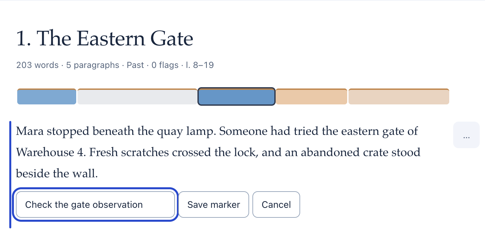

# Who sees the scratches first?

By [Matthias Fahsold](https://github.com/mfahsold) · Published 26 November 2026 · Updated 27 November 2026 · 4 minutes

Here is the first paragraph of the Warehouse 4 draft:

> Mara stopped beneath the quay lamp. Someone had tried the eastern gate of Warehouse 4. Fresh scratches crossed the lock, and an abandoned crate stood beside the wall.

Swap the last two sentences. Now you see the scratches and the crate while you are still wondering what happened at the gate. The opening has 28 words and three sentences either way. I would try the scratches first, then read into the next paragraph and see whether the crate draws the eye too soon. [Read the sample opening](https://github.com/mfahsold/lixity/blob/v0.9.3/samples/first-look.md#the-eastern-gate)

*A note in progress on the gate scene in the fictional Warehouse 4 manuscript.*

## Try the swap in a draft

In a local project, choose **Write → Versions → Compare versions**. Try the swap in **Draft to review** and read it beside the saved file. Lixity 0.9.3 uses the same analysis settings for both. If you bring the candidate into the editor, Lixity asks before replacing different unsaved text. Built-in analysis runs locally on your computer. [Version comparison](https://github.com/mfahsold/lixity/blob/v0.9.3/docs/WORKSPACE.md#compare-versions-and-resolve-a-conflict)

For a clue that arrives several scenes later, open **Story rehearsal**. Write “Who tried the gate?” on a **Question** card and give the clue its own **Revelation** card. Move the cards to see how long you would leave the question open. The manuscript and its measurements stay in their original order while you try it. [Story rehearsal](https://github.com/mfahsold/lixity/blob/v0.9.3/docs/WORKSPACE.md#compare-scene-evidence-and-rehearse-an-intent)

The film follows a different scene in the same manuscript. Mara wonders why the receiving line was left blank. I inspect the marked sentence and the research linked from the next paragraph, then compare a shorter version, save it and open the exported reading copy.

[Video walkthrough](../videos/product-tour.webm?v=3f2f355034d5)

[Video walkthrough](../videos/product-tour.mp4?v=b98531b576ee)

*Why is this sentence marked? A silent, 65-second film about checking a passage and preparing a reading copy in Lixity.*

[Watch with captions](../#product-tour-preview) · [Read the written walkthrough](../#tour-transcript)

## Hear where the clue lands

Read both openings aloud. In the revised order I would leave a pause after the crate, just before we learn someone tried the gate. **Listen and direct** keeps the paragraph in view while you write that direction down. **Author’s voice** lets you review a microphone take before keeping it. You can set a project limit of up to 60 seconds and use optional local SoundCraft trimming to review an excerpt with the original take still available. [Audio and direction](https://github.com/mfahsold/lixity/blob/v0.9.3/docs/AUDIO.md#author-voice-recording-and-listening)

Start at the gate in the read-only demo and pick the moment you would let the reader see the lock. Open an editable local copy when you are ready to try your version. The installation guide covers the published browser workspace, CLI and desktop test builds.

[Start at the gate](../guides/first-look.html#example) [Installation](../guides/installation.html) [Release notes](https://github.com/mfahsold/lixity/releases/tag/v0.9.3)

[All guides](../#guides)[Articles](index.html)[Source code](https://github.com/mfahsold/lixity)[License](https://github.com/mfahsold/lixity/blob/main/docs/LICENSING.md)[Website measurement](../#website-measurement)[Legal notice](../#impressum)
