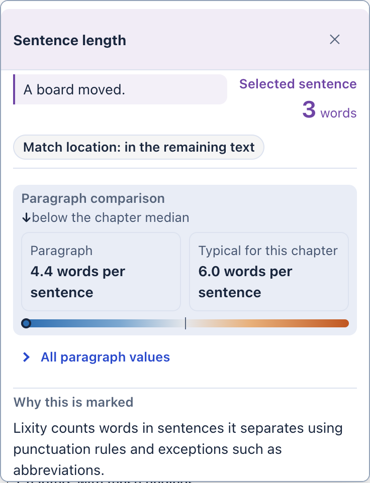

# A board moved. Should Mara turn in the same sentence?

By [Matthias Fahsold](https://github.com/mfahsold) · Published 26 November 2026 · 3 minutes

> A board moved. Mara turned. The crate tipped towards the drain.

Read that aloud. Now try *A board moved, and Mara turned. The crate tipped towards the drain.* With the full stop, the board moves and I have a moment to picture it. With *and*, I hear Mara’s turn as part of the same beat. The crate tips in exactly the same words. [The fictional Warehouse 4 manuscript](https://github.com/mfahsold/lixity/blob/v0.9.3/samples/first-look.md)

## Open the paragraph

In the read-only demo, choose **Try the draft examples → Inspect chapter 2**. At the first paragraph, open **… → Paragraph details → Explain this passage**. “A board moved.” counts as three words. The paragraph averages 4.4 words per sentence. Press Escape and read through to the moment Mara catches the crate. Where do you actually take a breath? [Open the demo](../demo/report.html) · [Find this passage](../guides/first-look.html#contrast)

*Sentence-length breakdown for the opening of Chapter 2 in the fictional Warehouse 4 manuscript.*

## Try the edit

The original excerpt has 11 words in three sentences. Joining the first two with a comma and *and* gives 12 words in two sentences. The actions and their order stay the same. I would keep the full stop here. I want time to see the movement before Mara reacts.

If you want to try it side by side, choose **Try the example offline** in a desktop test build and save an editable copy. Open **Write → Versions → Compare versions** and join the two sentences in **Draft to review**. Read them against the saved file before deciding which version to keep. [Install Lixity](../guides/installation.html#desktop) · [Compare versions](https://github.com/mfahsold/lixity/blob/v0.9.3/docs/WORKSPACE.md#compare-versions-and-resolve-a-conflict)

## Leave a note someone can use

“Give the board a beat before Mara turns.” That is a note I can use on the next read. **Listen and direct** lets you keep a delivery note beside the passage you are reading. [Passage direction](https://github.com/mfahsold/lixity/blob/v0.9.3/docs/AUDIO.md#passage-direction)

[Video walkthrough](../videos/editorial-loop.mp4)

*Follow a review mark and leave a note on the Warehouse 4 opening.*

I would like to hear where you paused. Does the full stop help you see the crate tip?

[Open the read-only demo](../demo/report.html) [Find this passage](../guides/first-look.html#contrast) [Share an observation](https://github.com/mfahsold/lixity/discussions/22)

[All guides](../#guides)[Articles](index.html)[Source code](https://github.com/mfahsold/lixity)[License](https://github.com/mfahsold/lixity/blob/main/docs/LICENSING.md)[Website measurement](../#website-measurement)[Legal notice](../#impressum)
