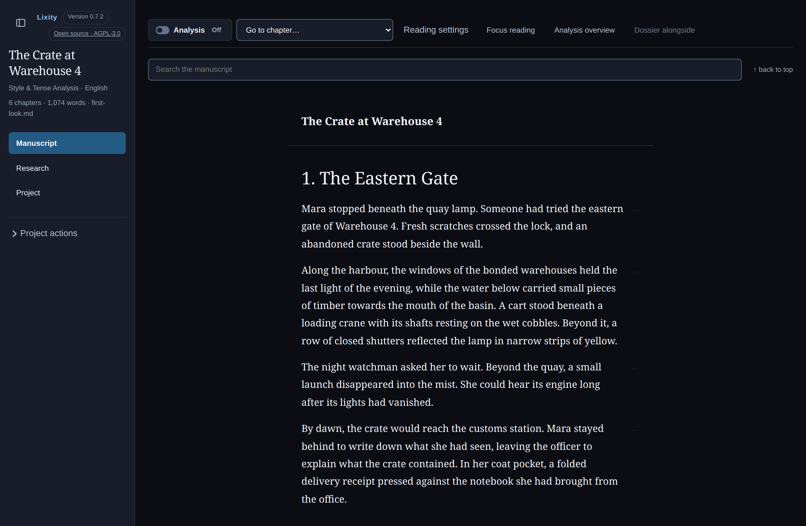

# Give the manuscript room to read

By [Matthias Fahsold](https://github.com/mfahsold) · Published 20 October 2026 · 5 minutes

A manuscript analysis tool can show you so much about a paragraph that the paragraph becomes awkward to read. Sentence patterns, source lines, markers and research links all have a purpose. They also compete with the next sentence.

Lixity v0.7.2 gives the manuscript more room. The interactive workspace opens as continuous prose with **Analysis Off**. The explicit **Analysis** switch displays its state in words; **Analysis overview** opens chapter comparisons with a direct **Back to passage** action. These reading controls are included in **v0.7.2**.

*The reader uses one continuous prose surface. This synthetic capture shows the reader controls; paragraph tools and the companion open separately.*

## Start with a scene

Open the [Warehouse 4 demo](https://mfahsold.github.io/lixity/demo/report.html). Its six short English chapters follow Mara through an invented harbour incident. Read the opening setting, then use the chapter control to move to chapter 2's action. You can compare their pace before opening a single measurement.

The reader uses ordinary scrolling and text selection. **A−** and **A+** change text size; **Reading settings** adjusts width and line spacing. Those preferences stay in your browser and leave the manuscript unchanged. **Focus reading** hides the surrounding navigation and side tools temporarily. Its return control, or Escape, brings the workspace back.

The aim is a usable reading surface with tools nearby. Manuscript text reflows when its size changes. Images, maps and the style-space view retain their own zoom or movement controls.

## Ask one question of a paragraph

Suppose an action passage feels slower than you expected. Open its **…** menu and choose **Values**. The closable **Passage values** inspector shows that paragraph's source lines and available tense and style measurements, independently of the Analysis On/Off choice. The **Analysis** switch alone reveals diagnostics without opening a side tool or narrowing the prose. Read the surrounding sentences while deciding whether those measurements explain anything useful.

The same contextual menu opens with a right-click. With the paragraph or its button focused, **Shift+F10** opens it from the keyboard; arrow keys move between actions and Escape closes it. Shift+right-click still reaches the browser's native menu. Selecting text within one paragraph offers a small toolbar when an applicable action is available.

Choose **Analysis overview** when the question calls for chapter comparisons or sentence rhythm. The manuscript remains mounted with the same paragraph text and source anchors. Hiding analysis keeps the active passage inspector or dossier available beside the text. A different sentence length can belong to a scene's purpose or a character's voice. The number locates a difference; reading supplies the judgment about what to do with it.

## Give research its own space

The Warehouse 4 story includes this sentence:

Someone had tried the eastern gate of Warehouse 4.

Open **Research → Dossiers**, then **View details** on **Warehouse 4 case notes**. The dossier brings together a claim about attempted warehouse entry, a retained customs-log passage and visual references. The incident, people and log are invented. The credited historical images provide visual context and do not verify the fictional incident.

Use **Dossier alongside** to consult a saved dossier while reading the manuscript. On desktop, the project navigation folds down to make room; you can reopen it, and closing the dossier restores the previous choice. Drag the divider to adjust the two reading areas. You can also focus the divider with Tab and use Left/Right; Home/End reach its limits. Narrow screens stack the documents.

Paragraph Values and the dossier replace one another as the active side tool. Each has a direct closing route. Display and companion changes try to retain the visible paragraph's position, so consulting context need not mean finding the sentence again. On narrow screens, opening a tool from a passage reveals its heading; closing it or pressing Escape returns to that passage and its control. Brief feedback marks reveals and returns without moving the manuscript surface; reduced-motion preferences disable the optional effects.

## Make the return route explicit

In Research's **Review** view, find the saved eastern-gate quotation. **Open claim** opens the authored claim; **Go to manuscript passage** returns to the exact matching text. The manuscript quotation, authored claim and retained source passage remain separate records. **Open claim** shows the linked claim revision and its dossier and source references; opening a newer version does not silently change those saved pins. When you begin through a manuscript paragraph's saved association instead, close the record viewer and choose **Back to passage** to resume that requesting manuscript text.

In a configured local project, you can select text within one manuscript paragraph and choose **Link selection to claim**. Review the quotation, choose an existing claim, explicitly permit local retention and save the association. Selecting text or previewing that form writes nothing. The saved connection records what you associated; it does not establish factual support or turn the manuscript into source evidence.

An exact return requires the current paragraph, line range and quotation to match its saved anchor. Changed or ambiguous anchors remain review tasks. Lixity does not silently infer a new connection. The public demo is read-only; saving associations requires a compatible local server and an explicitly configured research project. The research API remains experimental.

## Know which document you are reading

The browser reader now retains source structure around the same measured paragraphs: preface, subheadings, quotations, code, notes, dividers and excluded appendix material. Unmeasured text is labeled as reading-only. Paragraph quotation anchors still use the established exact analysis text; inline link/code syntax and pipe tables remain literal where present in that text. This is a reading surface, not a Markdown editor or a complete typesetting engine. Structured [book PDFs](https://mfahsold.github.io/lixity/guides/research-pdf.html#manuscript-export) keep their existing output behavior.

Built-in manuscript analysis runs locally without uploading the manuscript. Optional external workers have separate data boundaries, and retaining research sources requires permission. Measurements remain heuristic aids to human review.

Try one small loop in the demo: read the opening, inspect one paragraph, then follow the saved warehouse quotation into research and back. The [first-look guide](https://mfahsold.github.io/lixity/guides/first-look.html) walks through the same project. When you return from a research note, which context do you need to resume reading the sentence?

[Lixity home](../) · [All articles](index.html) · [Report a reproducible issue](https://github.com/mfahsold/lixity/issues) · [Legal notice](../#impressum)
