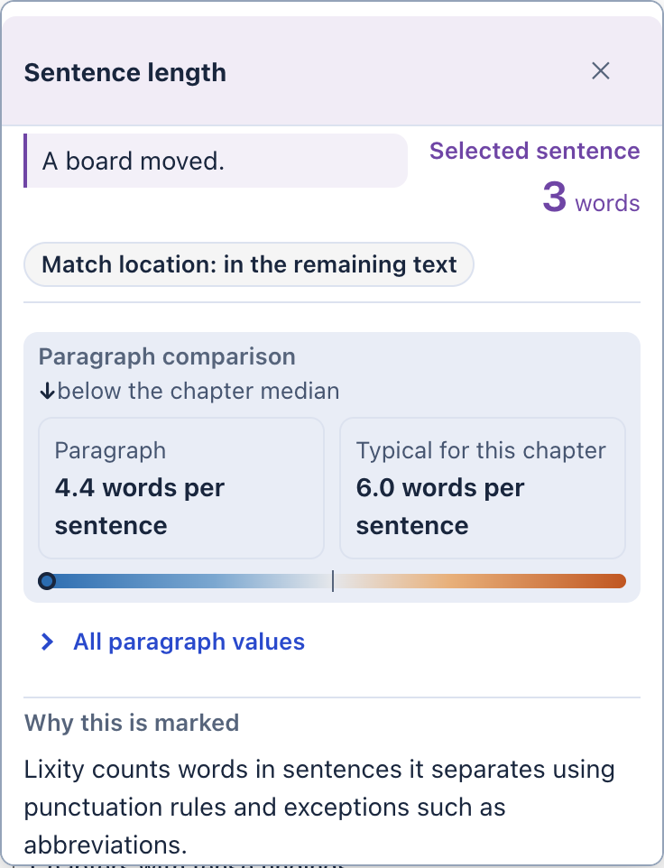
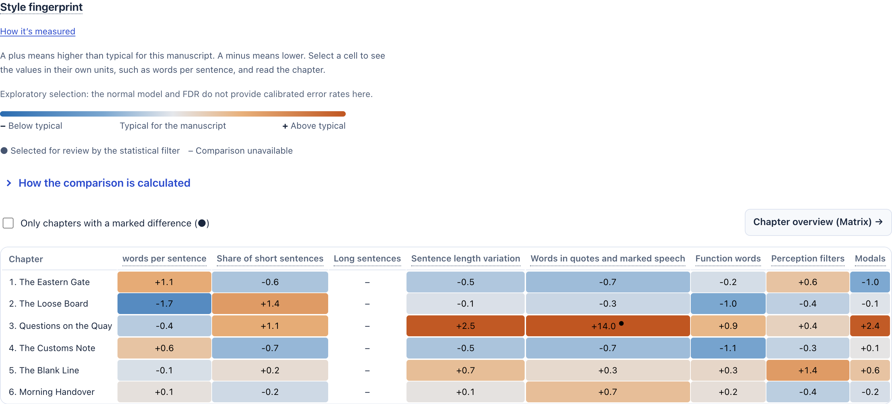
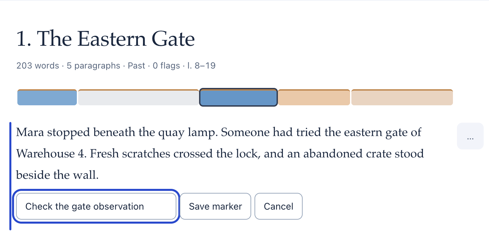

# Understand manuscript metrics and style consistency

Lixity describes patterns in the manuscript you provide. Its style reference compares chapters with that manuscript's own baseline. A signal is a reason to inspect a passage in context; it is not an objective quality score or an instruction to rewrite it.

Updated 20 November 2026

## Start with one question about the text

| Question | What to look at | What to read |
| --- | --- | --- |
| Where does the rhythm change? | In the chapter matrix, 12 words per sentence means the average sentence has 12 words. The sentence-length view shows how many sentences fall into each length range. | Read the start of both chapters aloud. Do the pauses fit what happens in each scene? |
| Where do characters speak? | 30% means about 30 in every 100 words are within recognized quotations or marked speech. | Open the counted text to see which passages are dialogue, thoughts, titles or quoted sources. |
| Why does this chapter stand out? | Choose a cell in the style comparison. The chapter value and the typical manuscript value appear in the same unit. | Open the chapter and look for a scene, narrator or passage that could explain the difference. |

[Compare two chapters of the demo](../demo/report.html) or [try a paragraph in the browser sandbox](../sandbox/index.html). For a specific value, the [measurement reference](metrics/en.html) explains what Lixity counts, the unit and what to check in the manuscript. The app’s **How it’s measured** links open the relevant entry in your interface language.

## Read the analysis marks

Turn **Analysis** on and choose a metric in **Measure**. The separate **Counted text** and **Paragraph comparison** switches let you inspect the counted passages, the chapter comparison, or both.

### Counted text

Violet underlines identify the exact words or sentences counted by the chosen metric. Open a mark to see the quotation, why it was marked and a question to consider as you read.

### ↓ ↑ Paragraph comparison

Blue/down and orange/up markers identify notable lower and higher paragraph values relative to the chapter. Their number is the paragraph's raw value. Color and direction describe a difference, not a quality grade.

A selected sentence's word count and its paragraph's comparison have different scopes. The explanation card shows them separately; **Read these marks** opens the counting and method details. **Focus reading** temporarily hides both displays and restores your choices on exit. [Try the marks in the short tour](first-look.html#passage).

In **Sticky sentences**, the underline marks a sentence that reaches the configured minimum length and share of function words. Open it to see both thresholds and the counted words, such as articles, pronouns and conjunctions. Read it aloud and see where you pause. In the repeated-word view, dashed marks link other occurrences of the same word in that paragraph. Read those occurrences together to see what the repetition does.

*Counted-text underlines and paragraph comparison markers inspect the same passage at two distinct scopes.*

Saved research uses neutral dotted marks and a book-icon **Research** control with its association count. It records an explicit connection to claims, dossiers and decisions. It stays visible with Analysis Off; counted-text marks and search backgrounds can appear on the same words. Use the Research control by keyboard or click an exact mark while no selection is active. A saved link does not establish factual truth or a statistical difference. [Visual roles and architecture](https://github.com/mfahsold/lixity/blob/main/docs/ARCHITECTURE.md#annotation-semantics-and-visual-identity).

## What does “Comparisons within the limit” measure?

In the style comparison, expand **How the comparison is calculated** to find this summary and the thresholds behind it.

This percentage counts measured chapter–feature cells whose noise-adjusted deviation stays below the active mild threshold. The JSON field is named `consistency`. A cell is one feature in one chapter, such as sentence length in chapter two. This is not simply the percentage of chapters that pass a test.

The baseline uses the chapter median and median absolute deviation (MAD). The default mild threshold is `|z*| < 2.5`; project and session settings can change it. A high percentage indicates fewer threshold crossings in this particular analysis. It does not certify narrative continuity, factual accuracy or literary merit. Constant features may remain within the band, so even a measured 100% needs contextual interpretation.

*The chapter–feature matrix compares each chapter against the manuscript's own median and MAD baseline.*

Retained research sources do not enter this manuscript baseline. An archived source is analyzed against its own chapters (`source_internal`); source–manuscript comparison is a separate, explicit lexical and register report. Travel accounts, monographs and their period or genre labels are evidence and user-supplied context, not an automatic writing standard. Archive integrity checks retained bytes and citations, not historical truth.

## Why does an empty manuscript show “–”?

The dashboard and text style report show a dash when no chapter–feature cells can be measured. This includes empty or heading-only manuscripts and material below the configured chapter minimum. A dash means unavailable, not zero quality or perfect consistency.

Style JSON retains the historical numeric `consistency` value for compatibility. The `measured_cells` field identifies the supporting count. When it is zero, the retained value `1.0` is a compatibility sentinel and must not be displayed as 100%. Older JSON without the field cannot establish availability from that number alone.

## Compare scenes within a register

The Scenes & style registers view measures scenes separately. Assign scene registers and target ranges in `lixity.toml`; each scene register has its own manuscript-only median. Chapter registers have a separate editor in Project settings, and display filters do not recalculate the whole-book reference. Counts and approximate standard errors show the data behind the values. Targets are your choices, not automatic writing rules. [Set up scene comparisons](https://github.com/mfahsold/lixity/blob/main/docs/USAGE.md#scene-registers-and-project-targets).

## How much text is enough?

| Signal | Implementation guard | Interpretation |
| --- | --- | --- |
| Style reference | At least the configured measurable chapter count; default 2 | A technical floor, not proof of statistical reliability. Several substantive chapters are more informative. |
| HD-D, MTLD, Maas a² | At least 100 tokens | Shorter inputs return unavailable results. Length robustness does not eliminate every sample effect. |
| MATTR | A 50-token window | Compare results only with consistent tokenization and settings. |
| Showing/telling ranking | At least three chapters with distinguishable balance scores | Otherwise the ranking lists are empty; numeric zero fallback scores do not establish artistic equivalence. |
| Readability | Language-specific formula and count heuristics | Formula estimates describe surface structure; they do not determine an individual reader's understanding. |

A token floor is an implementation policy, not a quality threshold. Maas remains defined for repetition: 100 repetitions of one token give `maas_a2 = 0.5`. Guiraud `V/√N` still depends on length and corpus composition. Flesch-family values can fall outside 0–100; they estimate surface structure, not reader understanding.

The showing/telling panel displays “–” with an explanation when there are fewer than three chapters or no comparative signals. Numeric fallback zeros remain in JSON for compatibility; they do not justify a ranking.

## A practical review loop

1. Check the manuscript path, selected language and chapter boundaries. English is the default; automatic language detection is an explicit choice.

2. Inspect an unusual chapter in the matrix or style bands. Distinguish raw threshold crossings from the separately computed FDR-selected cells.

3. Open the associated paragraphs and read the passage. A dialogue scene or deliberate change of narrator may explain the pattern.

4. Record your interpretation or a work marker if useful. A diagnostic does not decide whether to edit.

5. After changing the manuscript, compare results using the same analysis version, language and thresholds.

An opened paragraph shows the passage first, followed by a compact **Values** disclosure (**Werte** in German). Expand it to inspect the measurements. The matrix, reference bands, dimensions and structural diagnostics share one style area with tabs; links to their existing anchors select the relevant panel. Without JavaScript, all available style panels remain readable.

Open the 3D style space directly from the analysis overview when chapter scores are available. Each point is a chapter; nearby points have similar scores only on the displayed axes. A dashed ring marks an axis cutoff and a separate solid ring the selected chapter. Each dimension card reports the raw cutoff alongside its multiple of that axis's sample standard deviation so unequal axis spreads remain visible. The cutoff includes hidden axes and is not an FDR selection. The blue–orange scale elsewhere shows direction of comparison, not this cutoff. Use the 2D projections or chapter table when points overlap, then read the passage.

*Chapter overview, style bands and passage inspection keep quantitative signals tied to the underlying prose.*

Signs on the loading bars describe each feature’s direction within an axis, not quality. When fewer than three dimensions are available, coordinates set to zero solely for display are not measurements.

For example, a synthetic chapter consisting of short dialogue may differ sharply from a descriptive chapter. That contrast can be intentional. Neither moving both toward a common average nor maximizing consistency is a general writing objective.

For a scene or narrative-voice comparison, choose passages with comparable language, scope and discourse mode, then read the source text alongside sentence rhythm, dialogue, vocabulary and register measures. A dialogue-heavy scene and an expository scene need not share a target distribution. Short sentences do not establish dramatic pace, and few perception-filter verbs do not establish immersion. The tools do not identify speakers or validate a narrator's artistic voice.

**Perception filters and dialogue:** `filter_density`, modal, passive and nominal densities count the whole text, including quoted speech. A character who says “I believe this sanatorium…” contributes the same filter marker as a narrating voice would. When one of these values stands out, read the passages and compare with the chapter’s dialogue share: a high value inside dialogue is characterisation, not narration. A narrative-only variant of these densities is a documented candidate, not part of the current contract.

## Use signals as questions

Measurements point to passages for human review; they do not establish an error, artistic intent or a preferable style. Read dialogue, dialect, repeated words and changes in register in context. Choose when the analysis helps your own writing process.

## Signals and questions for review

Use this reference to connect a measurement with a question to investigate. None of these signals establishes a writing defect.

| Linguistic Feature | Calculation & Signal | Editorial Role & Application | Context to Check |
| --- | --- | --- | --- |
| **Sentence Rhythm & Length Tiers** | ASL, rhythm CV, staccato (≤6w), very long (>25w) | **Pacing:** Sentence-length variation can draw attention to shifts between action, dialogue and reflection. | Low or high CV and changes in long-sentence frequency invite a read of the passage; neither implies good or bad prose. |
| **Lexical Diversity** | Hypergeometric HD-D (McCarthy & Jarvis), MTLD, Yule's K | **Vocabulary Pattern:** These measures reduce some length sensitivity compared with raw TTR, subject to token floors and corpus context. | A later change may prompt a look at repetition, dialogue mix or topic shifts; it does not identify author fatigue or a quality problem. |
| **Tense Continuity & Friction** | Present, past, friction rating 0–3 | **Timeline & Perspective:** Heuristic labels locate passages with mixed tense cues; they do not prove a tense change. | Higher friction may merit a check of quotation, dialogue, flashback or deliberate perspective shifts before treating it as an error. |
| **Perception & Exposition Patterns** | Perception verbs, passive voice, nominal style | **Register:** Word-pattern counts highlight possible changes in viewpoint or exposition. | Read passages in context; these constructions can be deliberate and their counts do not measure immersion. Densities count matches per 1,000 words, not percentages; a few hits in a very short paragraph can produce a large value. Default nominal-suffix counts exclude known function words. |
| **Quoted passages and sentence length** | Default short blocks ≤12 words, long blocks ≥80 words, and mean sentence-length contrast in words per sentence | Compare a run of short quotation blocks with a sustained quoted passage. Read who has the floor and how that fits the scene. | Blocks describe the text. Speaker identity, story time and reader response require interpretation. The block-length thresholds are configurable in `CorpusConfig`. |
| **Paragraph cohesion and sentence starts** | Adjacent content-word overlap (%) and repeated sentence-start runs | Read adjacent sentences together to see which words carry the connection. | A run of at least three consecutive sentences beginning with the same token can prompt a review of repetition. The minimum is configurable with `monotony_min_run`. |
| **Editorial Presets & Register Profiles** | balanced, developmental, line_editing, conservative_by; 5 starter templates | **Curated Workflows:** Select threshold presets in Settings or CLI (`--preset`) to tune Lixity for macro structural editing vs. close prose line passes without manual arithmetic. | Presets prefill threshold fields as review filters; they are never prescriptive quality grades. Register templates provide author-adjustable starting ranges for dialogue scenes, action scenes, reflective narration, letters and records. |
| **FDR Heatmap** | Noise-aware z* shrinkage, Benjamini-Hochberg (●), Cliff's δ | **Statistical Review:** A dot marks a cell selected by the configured FDR procedure. Its probability model has not been calibrated for manuscript comparisons; effect size adds context. | Read flagged passages in context; a flag neither proves a defect nor calls for a rewrite. Unflagged passages can still matter artistically. |
| **Structural & Drift Diagnostics** | Guarded-cost changepoints, Mann-Kendall τ, Wasserstein-KS | **Structure Review:** These exploratory outputs suggest passages to inspect. They do not establish narrative boundaries or statistically confirmed shifts; see the [stability notes](https://github.com/mfahsold/lixity/blob/main/docs/STABILITY.md#structural-diagnostics). | A change point can prompt review of scene, character or chapter context; it does not identify an author handover or its cause. Structural trends need at least three chapters. Show/tell comparison also needs three chapters with differing signals; an unavailable comparison does not mean the app has failed. |
| **Persistent Work Markers** | <!-- LIXITY-MARKER id="..." kind="pruefen" --> | **Traceable Editorial Annotations:** Notes remain anchored near the target paragraph in Markdown. Export treatment is controlled by the project adapter. | Content hashes identify the originally marked paragraph; review anchors after manuscript edits. |

## Read each threshold in its own scope

The reference panel now includes one decision legend. The median ± 2σ band describes chapter spread without chapter SE; deviation flags and the comparison share use the active noise-adjusted z* cutoff. Nominal BH/BY selection uses normal tails from the same chapters and has no established error-rate calibration. Paragraph marks use their own within-chapter reference and a cutoff applied after rounding z to two decimals.

Two distinct comparable chapters receive z* scores, but in exact arithmetic their magnitude cannot exceed 1/1.4826. Numerical midpoint rounding is checked separately. The default 2.5 deviation cutoff is therefore unreachable; a per-feature notice explains this. More chapters do not automatically establish validity. Feature-rank projections now expose ridge regularization; their variance shares refer to the regularized matrix. The corrected Mahalanobis distance uses the same rank coordinates as its covariance; earlier values must be recomputed.

## Does FDR make a flagged passage objectively wrong?

No. Benjamini–Hochberg and Benjamini–Yekutieli require valid input probabilities to control false discoveries. Lixity's normal-tail probabilities have not been calibrated for comparisons against a baseline estimated from the same chapters. The configured q is therefore not a guarantee of the manuscript's false-alarm rate. A dot is a selection for review, not statistical confirmation or a judgment of prose quality.

The style summary labels the share of feature comparisons within the threshold and shows its numerator and denominator. For example, 407 of 416 comparisons is about 98%; this is not a measurement of stylistic cohesion. Missing comparisons are excluded. When no comparison is available, the summary remains unknown.

## What can tense and pacing labels tell me?

Read the word ranges next to the sentence groups. The sentence-length distribution uses four groups. The detailed pacing profile uses three groups to describe how widely sentence lengths vary.

Open the rhythm view and choose a chapter or length group to read examples in the manuscript. Word-pattern examples show whether the match is inside a quotation or marked speech, outside it, or across a boundary. Unclear boundaries are reported separately. In the motifs view, open a repeated phrase to see which occurrences can be highlighted together.

The passage card distinguishes mixed tense cues from a dominant-tense change since the previous paragraph. Open an original counted form to locate it in the manuscript; repeated forms have separate locations. Counts, other paragraph values and general heuristic help start collapsed. If a cue cannot be mapped reliably, Lixity says so. Mixed cues alone do not establish a tense switch.

Tense labels, dialogue detection, pacing indicators and showing/telling patterns are language-dependent heuristics. Quoted speech, ambiguous word forms and unconventional punctuation can affect them. A friction rating locates mixed signals; it does not determine whether a flashback or tense change is mistaken. Read the original paragraph before making an editorial decision.

The review overview makes these limits explicit. Tense cues are word-pattern counts, not a grammatical parse: infinitives and auxiliary forms can be ambiguous, and quoted recollections can mix present and past cues intentionally.

Without explicit scene dividers, `scenes_are_chapters` is true and scenes use chapter boundaries. Lixity counts words within recognized quotations or marked speech and total words with the same configured word pattern. Read the context to determine who speaks.

## Read the values as well as the colors

Use the labels, numerical values and selected thresholds alongside a chart's colors. Interface accent colors identify links and controls; analysis colors encode a particular measure or state. A prominent or saturated cell does not necessarily represent a large effect, a reliable estimate or a writing problem. Theme preference does not change the underlying analysis.

Style axes summarize patterns in ranked chapter measurements. Their variance labels describe eigenvalue shares of the regularized rank matrix, not necessarily empirical score-variance shares, raw word-count variance or quality. Only chapters with all required measurements appear in the plot; its footer shows coverage. At least three complete chapters and three varying features are needed, which does not establish a reliable narrator or register classification. See the [methods notes](https://github.com/mfahsold/lixity/blob/main/docs/METHODS.md#5-exploratory-style-dimensions).

Heatmap cells, reference cutoff-hit counts and all style-space loadings open the same chapter measurement view. Read the definition, unit, sample and manuscript reference alongside the other metrics of that chapter. Switching metrics does not change manuscript marks. **Read chapter** deliberately opens the text; chapter-only metrics clear unsupported paragraph layers. An axis loading is not a chapter contribution, and comparing metrics does not establish causality.

Display label keys such as `feat_asl` are not API functions or result fields. Read actual model keys: corpus metrics use `asl`, `dialog_ratio` and `filter_density`; chapter metrics use `asl`, `dialog_pct` and `filter_density`. Style feature identifiers appear in `features[].feature` and deviation/FDR entries. Keep the scope and units with each reported value.

## Are the seven languages equally accurate?

The interface and language profiles cover English, German, French, Spanish, Italian, Portuguese and Dutch. English and German have the deepest linguistic heuristics. Complete translations of interface text do not establish equal linguistic accuracy. Mathematical identifiers stay language-neutral; quotations retain their original language.

Read the [estimator definitions and scientific references](https://github.com/mfahsold/lixity/blob/main/docs/METHODS.md), [stability and limitations](https://github.com/mfahsold/lixity/blob/main/docs/STABILITY.md), and [JSON contracts](https://github.com/mfahsold/lixity/blob/main/docs/AGENTS.md). For a first run, follow the [Warehouse 4 project walkthrough](first-look.html).

[All guides](../#guides)[Articles](../blog/index.html)[Source code](https://github.com/mfahsold/lixity)[License](https://github.com/mfahsold/lixity/blob/main/docs/LICENSING.md)[Website measurement](../#website-measurement)[Legal notice](../#impressum)
