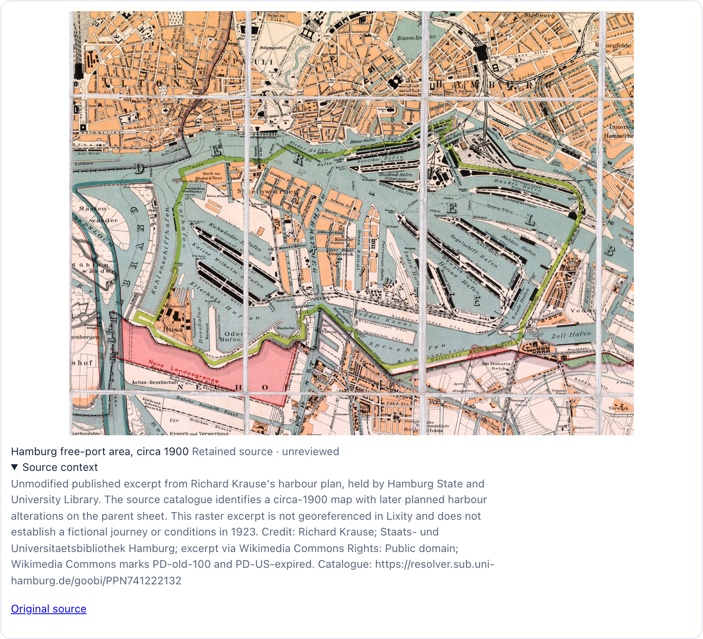
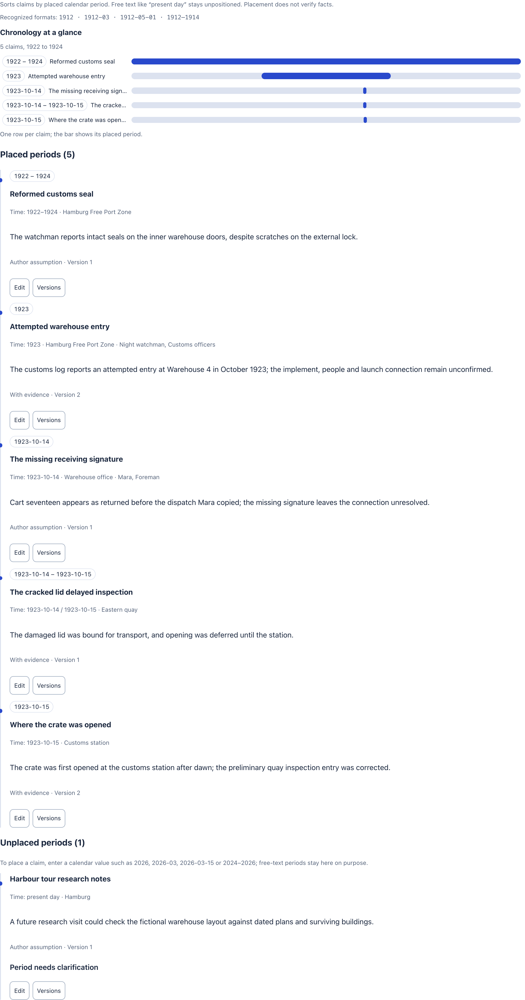

# Connect research to your manuscript

Collect sources, read and annotate in Zotero. Use Lixity's research workspace to connect selected evidence with claims, authorial decisions and exact manuscript quotations. A capture preserves the source version you used; it does not establish that a claim is true.

This walkthrough introduces the author workflow. The [research manual](https://github.com/mfahsold/lixity/blob/main/docs/research/USAGE.md#find-a-task) owns the detailed procedures and compatibility rules; [design history](https://github.com/mfahsold/lixity/blob/main/docs/research/README.md#design-history) is separate from implemented commands.

Updated 23 November 2026

**Before importing:**

Choose the intended project and confirm that you may keep the source bytes. Text PDFs need Poppler; image-only scans need local Tesseract or a configured OCR worker. See

[installation](installation.html#install)

and

[PDF requirements](#ocr)

.

<a id="import"></a>

## Import a local source

Start with a source you are allowed to retain. This synthetic example assumes you saved a short note as `source.txt`. Initialize only a new research archive:

```
lixity research init --project ./sample-project --title "Sample research" --language en
lixity research ingest --project ./sample-project --file ./source.txt --allow-retention --origin-url https://example.org/archive/source
# Or import several files with phase-change messages:
lixity research ingest --project ./sample-project --file ./sources/*.txt --allow-retention --progress
lixity research search --project ./sample-project --query "reading room"
```

`--allow-retention` confirms your permission to keep source bytes locally. It neither grants redistribution rights nor makes a claim true. Avoid importing sensitive sources into public repositories.

For an authorized file outside Zotero, open **Research → Sources → Add local source**. Choose a text or PDF file, or paste text, and confirm retention. A failed submission keeps the draft. The same workspace offers local import and Zotero capture.

For a visual reference, open a dossier and choose **Add image**. Preview an authorized local PNG/JPEG, describe it and confirm retention before saving. The original image and dossier version are saved together. Earlier versions keep their exact image; removed images show an unavailable placeholder. Images have no extracted text or linguistic scores. See [format limits and archive compatibility](https://github.com/mfahsold/lixity/blob/main/docs/research/USAGE.md#keep-a-visual-reference-in-a-dossier).

<a id="origin-url"></a>

## What does the origin URL do?

This field records the original HTTP(S) address in source details and citations. Lixity does not fetch the page or monitor it. Use a stable public address where appropriate; credentials and whitespace are rejected. Do not include private access tokens or signed download links.

Matching URLs do not merge sources. Refreshing a named source with a new URL creates a new capture; earlier citations keep their original text and URL. These captures use the v2 archive format. Back up before upgrading and use compatible readers and writers; see [archive compatibility](https://github.com/mfahsold/lixity/blob/main/docs/research/USAGE.md#limits).

<a id="zotero"></a>

## Keep source work in Zotero

Zotero owns bibliographic metadata, ordinary reading, annotations and general notes. Lixity's attachment selector captures only the evidence versions needed for your project; **Open in Zotero** returns to the source for further work.

Run Zotero on the same computer and download the attachments you need. Open **Research → Sources → Capture from Zotero**, choose a library and collection, inspect an item, select an eligible attachment and confirm retention. Lixity reads the local API. Eligible attachments include PNG/JPEG alongside PDF/text. Audio, video and unsupported attachments remain in Zotero.

Captured evidence stays readable when Zotero is closed. Refresh linked sources explicitly when they change; old quotations stay intact. There is no background synchronization. Zotero captures need the v3 archive format, which older readers cannot open.

To bring existing Lixity sources into Zotero, `research zotero-export` creates a RIS import bundle with retained files and their identifiers. Export preserves the Lixity archive. Follow the [setup, migration and compatibility reference](https://github.com/mfahsold/lixity/blob/main/docs/research/USAGE.md#zotero-desktop-bridge-since-v1190), and verify imported files before relying on the new workflow.

<a id="places-and-routes"></a>

## Read a place alongside its sources

In the [Warehouse 4 demo project's Research view](../demo/report.html#research-manager), open **Warehouse 4 case notes** to inspect the historical Hamburg map, photochrom, source links and authored walking/driving sketch. Its claim, customs-log passage and saved manuscript quote belong to the same project used by Analysis and the PDF copies. The historical images do not establish the invented event or journey.



*Historical visual references stay attached to exact source versions. [Mobile map view](../screenshots/dashboard-dossier-image-mobile.webp) · [Harbour photochrom](../screenshots/dashboard-dossier-photo.webp) · [Places and journeys](../screenshots/dashboard-dossier-geography.png) · [Credits and file hashes](../assets/research/sources.json).*

Use **Places and routes** in the dossier editor for named points, paths and areas. In the local app, maps open with OpenStreetMap; turn off the background or choose the numbered sketch for offline use. Exported reading websites keep their map geometry offline and make no tile requests. Tile requests disclose the viewed area and client IP to the provider and stop outside the visible map/project context. The view explains its measurements and limits; historical map images remain separate evidence. See [geography and v8 compatibility](https://github.com/mfahsold/lixity/blob/main/docs/research/USAGE.md#keep-places-and-journeys-in-a-dossier).

Images and rendered diagrams share a [local zoom viewer](../screenshots/dashboard-dossier-image-zoom.webp). [Mermaid diagrams](../screenshots/dashboard-dossier-diagram.png) retain their source; restricted or unsupported syntax stays readable as source. No CDN or diagram upload is required.

<a id="search"></a>

## Search sources and current notes

**Search research** opens a shared tool above the selected research content. It includes retained source passages and current dossiers, claims and decisions. Choose a narrower scope when needed, then use **View entry** to read a current authored record or open a source passage to inspect its citation. For strict CLI reads, `--strict` reports an outdated index.

For a known source or dossier, its list filter narrows the loaded title and tag metadata immediately. Use **Search research → All records** to find words inside retained text and current authored notes; earlier versions are outside that search.

```
lixity research search --project ./sample-project --query "inspector" --scope all
lixity research search --project ./sample-project --query "inspector" --scope decisions
```

The CLI defaults to source passages. Search matches words in current records, not their history; it does not reconcile conflicting claims or decide whether a proposal is final. Keep decisions and open questions explicit in your notes.

<a id="keyword-citation"></a>

## Choose a citation by keywords

Select a claim in the evidence form and choose **Find source passage**. Search opens with **Sources** selected and keeps your claim choice. Read a match, choose **Use for claim**, then review the full paragraph, select the evidence relation and save explicitly. A search match or draft does not verify a claim or create a saved link.

```
lixity research cite --project ./sample-project --query "reading room"
# For multiple matches, repeat the same query and displayed snapshot:
lixity research cite --project ./sample-project --query "reading room" \
  --pick 2 --expected-snapshot SNAPSHOT_SHA256
```

One match resolves the existing full-paragraph citation. Zero or multiple matches return search JSON and exit `1`; multiple matches print numbered choices on stderr. A numbered choice requires the same query and displayed snapshot. Changed snapshots or unavailable sources require another search. Exact `--passage` retrieval remains available for historical captures. See the [selection and API reference](https://github.com/mfahsold/lixity/blob/main/docs/research/USAGE.md#choose-citations-by-keywords-since-v300).

<a id="evidence-draft"></a>

## Prepare evidence from selected source text

Open a retained source and select text within one uniquely resolved paragraph. The selection action prepares the existing claim evidence-link form. Its preview shows both your selected quote and the full retained paragraph; choose a claim and relation, add your own rationale if needed, then save separately.

The saved citation still identifies the whole paragraph and its source version. It creates no sentence-level citation. Cross-paragraph or ambiguous selections are unavailable; use the whole-passage actions in the Passages view instead. Selecting text or opening the draft writes no record. Evidence status labels express your own assessment, not historical certainty or a computed probability.

For reading notes against the manuscript, open **Dossier alongside** in Manuscript and choose a dossier, or use the action on that dossier's card. The optional companion reader is read-only. Closing it preserves manuscript search and open paragraphs; refresh explicitly for the latest saved dossier version. Narrow screens place the dossier above the manuscript.

<a id="manuscript-claims"></a>

## Associate manuscript text with a claim

Select text within one opened manuscript paragraph, choose **Link selection to claim**, choose a current claim, permit local retention of the quote and select **Save association**. Previewing writes nothing. Saving keeps a manual association to the exact claim version, with the quote and paragraph anchor; it does not import the complete manuscript or edit prose.

Exact resolved quotes have neutral dotted marks and a book-icon Research control, separate from analysis colors. Changed text or claim versions request review; an edit outside the quote resolves as *adjusted* and can be re-pinned explicitly in the review tab (or with `reconcile-manuscript --accept-moved`), while edited quotes and ambiguous paragraphs remain unresolved. Saved associations are listed in the research **Review** tab with their anchor state and review flags; listing them never writes or repins. These flags do not establish a contradiction or factual support. Both dossier readers show current linked claims with saved-version history and active saved quote counts. Zero saved links does not establish that a claim is unused in prose.

Choose **Explore passage → Research for this passage**, a passage association count or a marked quotation to open its linked context beside the manuscript. Quotations of the same claim share a compact card; current dossier decisions have a separate count. Titles open current entries; **Linked version** opens the exact earlier claim or dossier version retained by the association. Current decisions do not reconstruct the quotation's historical state. **Review** opens the dedicated anchor review. Opening context writes nothing, and an empty summary means only that this passage has no saved associations.

**Before the first save:**

back up the archive. Retention-confirmed manuscript links require record/manifest v7 support. Archive, physical-storage and response versions have independent compatibility rules. Exported quotes remain private manuscript material. See

[anchoring, retention and compatibility](https://github.com/mfahsold/lixity/blob/main/docs/research/USAGE.md#associate-a-manuscript-quote-with-a-claim)

.

<a id="dossiers-and-decisions"></a>

## Edit dossiers and review decisions

Under **Research → Dossiers → From manuscript**, choose a character, scene or place suggestion and review the proposed text before saving. A character suggestion starts with mention counts and a first passage. Open the generated dossier’s **Character in the manuscript** section for the chapter table and full matching passages with neighboring sentences where available. **Add from manuscript** lets you review that material and save it alongside your notes. Go back to the text to check who a name refers to before using the suggestion.

Open a dossier to read its notes, linked claims and source quotations. Use **Edit section** beside a unique heading for a bounded change, or **Edit** for the full record. Select correction or supersession, give a reason and save explicitly. An unchanged save keeps the existing revision; a changed save appends history. For an external editor, use the [export → edit → preview → apply procedure](https://github.com/mfahsold/lixity/blob/main/docs/research/USAGE.md#edit-an-exported-markdown-dossier). Ordinary source import does not create an authored dossier.

In **Review**, open **Read decision with dossier** to compare the named versions. **Mark as applied** records your assessment for those exact versions; it does not update old pins or inspect prose. A later revision may need another review. The manual covers [concurrent drafts](https://github.com/mfahsold/lixity/blob/main/docs/research/USAGE.md#resolve-conflicting-drafts) and [saving related changes together](https://github.com/mfahsold/lixity/blob/main/docs/research/USAGE.md#review-decisions-and-save-related-revisions-together).

<a id="dossier-export"></a>

## Download a dossier PDF

In the current development workspace, open a saved dossier and select **Download PDF**. Check the version shown beside the button. You can download that version from the dossier, beside the manuscript, or after opening it from the dossier’s history.

The A4 copy includes saved notes, chapter tables, place and route descriptions, and source quotations pinned to that version. Use the PDF reader’s bookmarks to jump between sections. Save a new manuscript excerpt as a dossier addition to include it in your next download. Use the attachment controls for original files and the research view to inspect current claim links.

Open [Mara’s saved dossier in PDF](../demo/warehouse-4-dossier.pdf) to see the chapter distribution, manuscript passages and a pinned source quote from the fictional Warehouse 4 project.

For the whole draft, use the [manuscript PDF layouts](#manuscript-export). For a browser-based reading copy with selected background, use the [reading website export](#reading-website).

<a id="claim-chronology"></a>

## Organize claim periods and causal interpretations

Inside **Claims**, choose **Timeline**. It places valid four-digit CE years, `YYYY-MM` months, ISO dates and supported ranges while preserving your original period labels. Missing, unclear or invalid periods remain visible under **Unplaced periods**. Reading makes no archive changes, and creation dates never stand in for historical periods.

The timeline sorts claims by the calendar value in their period and shows how the placed spans relate. Every dated claim is one row on a shared axis; the badge repeats its placed range and **Placed periods** lists the full cards below. Free-text periods such as *present day* are not calendar values, so they stay under **Unplaced periods** with a reason and a formatting hint. To place a claim, enter a value like `1926`, `1926-03`, `1926-03-15` or `1924–1926`; the claim form shows these formats and a save reports an unplaceable period as a warning. The axis shows only what you entered; placement never verifies a historical fact.

[Video walkthrough](../videos/research-timeline.mp4)

*Short walkthrough: open **Claims**, switch to **Timeline**, follow a row to its claim and read the placement hint ([also as GIF](../videos/research-timeline.gif)).*



*The chronology strip, placed cards and the placement hint in one view.*

Under **Cause and effect claims**, choose a proposed cause and effect, review their saved versions and save your interpretation explicitly. A later claim edit leaves the link pinned to its earlier versions and marks it for review. Edit or retract through the shared revision editor; earlier interpretations remain in history. Self-links are rejected, cycles are allowed, and no causal truth or additional links are inferred.

**Before the first causal save:**

back up the complete archive. A saved causal link requires record/manifest v6 support. Product numbers and archive capabilities are independent. Check

`lixity about --json`

and the

[current compatibility table](https://github.com/mfahsold/lixity/blob/main/docs/research/USAGE.md#limits)

; older physical stores may also need the explicit manifest migration. Reading the timeline changes no record schema.

```
lixity research timeline --project ./sample-project --format text
lixity research relate --project ./sample-project FROM_CLAIM TO_CLAIM \
  --relation causes --rationale "Author interpretation for review"
```

Replace the claim placeholders with complete IDs from the claim list. `results_in` is an alias for `causes` in the same cause-to-effect direction. Software consuming claim lists must update to the uniform `research-claims-local/2` envelope; stored claims remain unchanged. Read the [implemented chronology and compatibility reference](https://github.com/mfahsold/lixity/blob/main/docs/research/USAGE.md#claim-chronology-and-causeeffect-links) for accepted periods, revision guards and retraction.

<a id="cli-project"></a>

## Use the intended research project in the terminal

Existing-archive commands may omit `--project` only when your current directory is itself a validated initialized research project. Lixity does not search parent folders or reuse the browser's last project. An explicit `--project` remains authoritative. Initialization still names its project.

```
cd ./sample-project
lixity research search --query "reading room"
lixity research link urn:uuid:YOUR-PASSAGE-UUID urn:uuid:YOUR-CLAIM-UUID --relation contextualizes
```

Use returned IDs, passage first and claim second. Complete bare UUIDv4 selectors and plural aliases in grouped help are also supported. The short command creates an evidence link; `link-evidence` retains inspection and revision operations. See [scope and compatibility](https://github.com/mfahsold/lixity/blob/main/docs/research/USAGE.md#reading-and-cli-workflows-since-v240).

<a id="grounding"></a>

## Compare vocabulary with your manuscript

Beyond individual citations, Lixity can compare word occurrences in a retained source and your draft. Matching words do not establish factual agreement or source influence. Source-internal analysis (`lixity research analyze` / `dashboard`) inspects a single source against its own chapters, while **Research → Sources → select a text source → Compare vocabulary with manuscript** (`lixity research compare`) compares one retained source against your manuscript:

- **Lexical overlap & keyness:** Jaccard similarity, overlap coefficient, shared content-word types, Dunning *G²* source key terms, and terms exclusive to either text.

- **Chapter grounding density:** Per-chapter word counts, shared tokens, and density so you can see where historical vocabulary concentrates across the manuscript.

- **Register & style contrast:** Side-by-side deltas for mean sentence length (ASL), dialogue share (%), vocabulary richness (Guiraud *R*), and vocabulary repetition (Yule's *K*).

For structured external workflows, the research archive also supports **dossier collections** (ordered reading lists in `lixity.toml`), deterministic character/location/scene drafts (`dossier-drafts`), bounded MP4/WebM video attachments (`lixity:media/...`), offline HTML article extraction (`extract-article`), a Claim–Evidence–Decision matrix (`matrix` in Markdown, CSV, or JSON), and **JSON Canvas 1.0** graph export (`canvas`). Audio files remain outside the research source archive.

<a id="ocr"></a>

## Can Lixity read scanned PDFs?

A PDF with selectable text can use local Poppler tools. An image-only scan needs locally installed Tesseract or a configured OCR worker to recognize text. Installing Lixity does not install either engine, download a model or start a worker service.

```
lixity research ocr-status
lixity research ingest --project ./sample-project --file ./document.pdf --allow-retention
```

Diagnostics identify missing tools, language data and configuration errors with corrective guidance. A ready engine or successful synthetic probe does not measure recognition accuracy; automation must inspect `probe.ok`, not just the exit code. See [diagnostic states and failure semantics](https://github.com/mfahsold/lixity/blob/main/docs/research/USAGE.md#native-pdfs-versus-scans).

Install `poppler-utils` on Debian/Ubuntu or `poppler` with Homebrew on macOS. The server must be able to find `pdftotext` and `pdftoppm`. Check extracted quotations against the original PDF; configuration checks do not measure recognition accuracy.

Scans can use locally installed Tesseract without a separate worker service. Set `LIXITY_OCR_BACKEND=tesseract` and choose installed language data with `LIXITY_OCR_LANGUAGES` (default `eng`), then restart the server. Diagnostics list missing languages. New native Poppler and local Tesseract captures require a v4 archive reader; existing cached provenance stays unchanged. [Local OCR setup and compatibility](https://github.com/mfahsold/lixity/blob/main/docs/research/USAGE.md#use-local-ocr-without-a-worker-service).

<a id="worker"></a>

## Connect an existing self-hosted worker

This is optional technical setup for a separately maintained model adapter. The [deployment guide](https://github.com/mfahsold/lixity/blob/main/docs/research/OCR_INTEGRATION.md) explains the worker boundary and records the retired CPU experiment. Baidu's tools cannot be used directly as a Lixity worker.

Set `LIXITY_OCR_WORKER` to one executable path, not a shell command. The default timeout is 120 seconds; `LIXITY_OCR_TIMEOUT` accepts 1–3600 seconds. A configured worker failure or incomplete result rejects the import unless native fallback is explicitly allowed. Native extraction can omit scanned pages in mixed PDFs; inspect its page warnings. See the [worker interface and limits](https://github.com/mfahsold/lixity/blob/main/docs/research/USAGE.md#self-hosted-pdf-and-ocr-extraction) for the JSON contract.

```
export LIXITY_OCR_WORKER=/absolute/path/to/ocr-worker
lixity research ocr-status
lixity serve /absolute/path/to/project --host 127.0.0.1 --port 8765
```

These commands use a POSIX shell. Use equivalent environment settings on Windows or in a service, then restart the server. Test a synthetic scan and compare its extracted quotation with the page.

Lixity retains the original PDF and extracted text separately. Citations identify spans in that text; they do not provide audited page coordinates or recognition confidence. Consult the original when visual evidence matters.

<a id="backup"></a>

## Back up and test restoration

The project's `research/` folder contains the evidence archive. The search index can be rebuilt and is not a backup. Keep backups outside public repositories and avoid writes while exporting.

```
lixity research export --project ./sample-project --output ./sample-backup.tar.gz
lixity research restore --from ./sample-backup.tar.gz --to ./restored-sample
lixity research audit --project ./restored-sample
lixity research reindex --project ./restored-sample
lixity research search --project ./restored-sample --query "reading room"
```

Restore into a new, empty target. Restoration checks paths, checksums and record links. Resolve a known passage afterward to check its quotation and original URL. A successful audit checks archive integrity, not historical truth or permissions.

`research zotero-backup` pairs the archive with a selected Zotero data folder; you must close Zotero first. `research zotero-restore` verifies and restores both into a new directory without replacing a working library. Manuscripts, application profiles and external linked attachments need separate backups. Test a restored citation and follow the [paired-backup reference](https://github.com/mfahsold/lixity/blob/main/docs/research/USAGE.md#paired-zoteroresearch-backup-and-restore) before relying on the pair.

<a id="cli-workflow"></a>

## Command-line example: sources to decisions

For authored notes, use the explicit [Markdown export → edit → preview → apply workflow](https://github.com/mfahsold/lixity/blob/main/docs/research/USAGE.md#edit-an-exported-markdown-dossier). The archive stays authoritative; a reviewed packet binds its project and snapshot. Exact update dry runs validate a proposed write, historical diffs compare saved revisions, and three-way preparation reconciles a draft. Source ingest is separate and does not create authored notes from Markdown exports.

This optional example uses authorized local source files. Replace paths and UUID placeholders with the files and identifiers returned by earlier commands. Initialize the archive only once, and prepare `./sources/harbor-dossier.md` before importing that dossier.

**Show the complete command-line example**

```
# 1. Initialize a dedicated research workspace
lixity research init --project ./novel-research --title "1920s Archive" --language en

# 2. Ingest primary source with cultural source criticism and explicit retention
lixity research ingest --project ./novel-research --file ./sources/police_log_1923.txt \
  --context '{"genre": "Police Log", "created_period": "1923", "place": "Hamburg", "provenance_note": "State Archives"}' \
  --allow-retention

# 3. Rebuild search explicitly (ordinary search refreshes it automatically)
lixity research reindex --project ./novel-research

# 4. Search source passages; add --scope all for current authored records
lixity research search --project ./novel-research --query "dockyard customs" --limit 5

# 5. Resolve a passage citation (paragraph, exact offset, source metadata)
lixity research cite --project ./novel-research --passage urn:uuid:PASSAGE-UUID-HERE

# 6. Run linguistic source analysis and generate standalone source dashboard
lixity research analyze --project ./novel-research --source-id urn:uuid:SOURCE-UUID-HERE
lixity research dashboard --project ./novel-research --source-id urn:uuid:SOURCE-UUID-HERE > source_report.html

# 7. Compare source and manuscript vocabulary; create a dossier
lixity research compare --project ./novel-research --source-id urn:uuid:SOURCE-UUID-HERE --manuscript ./manuscript.md
lixity research dossier --project ./novel-research --title "Harbor Evidence" --file ./sources/harbor-dossier.md --tags "harbor"

# 8. Record a claim, passage relation, and authorial decision
lixity research claim --project ./novel-research --title "Harbor opening" --statement "The harbor opened in 1923." --confidence hypothetical
lixity research link-evidence --project ./novel-research --claim-id urn:uuid:CLAIM-UUID-HERE --passage-id urn:uuid:PASSAGE-UUID-HERE --relation supports
lixity research decision --project ./novel-research --title "Shift opening date" --rationale "Narrative chronology" --claim-id urn:uuid:CLAIM-UUID-HERE --deviation-from-fact

# 9. Open a foreground research dashboard (stop with Ctrl+C)
lixity serve --research-project ./novel-research --no-project

# 10. Audit repository integrity and snapshot checksums
lixity research audit --project ./novel-research
```

For the managed app instead, use `lixity service start --open` and **Open Project** to select the archive. See the [lifecycle guide](installation.html#restart).

<a id="manuscript-export"></a>

## Export print-ready PDFs and editorial copies

Open **PDF export** in the workspace bar (or run `lixity pdf`) to compose pure-Python PDFs with TrueType subsetting, Identity-H CID / ToUnicode glyph mapping, orphan/widow control, and PDF bookmarks. Each of the five layouts targets a distinct stage of drafting, editing, or printing:

| Layout (`--layout`) | Page & Margins | Typography & Grid | Editorial / Print Features |
| --- | --- | --- | --- |
| `editor` (*Lektoratsfassung*) | DIN A4, single-sided; `62 pt` left (incl. `22 pt` gutter), `96 pt` (~34 mm) right correction margin | `12 pt` serif, `1.5×` leading (`18 pt` grid), ragged right, no hyphenation | 1-based per-page line numbers in the left gutter, running header (`title · author · draft_notice`), `{folio}/{pages}` footer, chapter page breaks |
| `book` (Print reading copy) | A5 (`419.5 × 595.3 pt`), **mirrored recto/verso margins** for duplex printing & binding | Serif, `BOOK_CPL = 64` target width, `1.45×` leading, Knuth–Plass-style DP justification, first-line indents | Title page, centred chapter headings, running header, omitted first-page folio, optional **A5 imprint page** |
| `sheet` (*Normseite*) | DIN A4, centred horizontal margins, `54 pt` top/bottom | `12 pt` monospace, fixed **30 lines × 60 columns** submission grid | Running draft header and `{folio}/{pages}` footer in `8 pt` monospace |
| `report` (Analysis report) | DIN A4, `62 pt` side / `56–78 pt` vertical margins | Sans-serif, `REPORT_CPL = 78`, `1.5×` leading | Cover page, PDF bookmarks, Markdown tables with auto-fitted widths, right-aligned metrics, and **repeating headers** across page breaks |
| `document` (Neutral A4) | DIN A4, uniform `72 pt` margins | `12 pt` / `16.2 pt` baseline, `8.1 pt` paragraph gap | Clean reading document without title page, running headers, or page numbers |

```
# Editorial copy with 34 mm correction margin and gutter line numbers
lixity pdf manuscript.md --layout editor -o editorial.pdf

# Print-ready A5 book spread with mirrored margins and imprint
lixity pdf manuscript.md --layout book -o print-a5.pdf
```

Override system-discovered fonts via `LIXITY_PDF_FONT_SERIF`, `LIXITY_PDF_FONT_SANS`, or `LIXITY_PDF_FONT_MONO` when needed. See the [browser workspace manual](https://github.com/mfahsold/lixity/blob/main/docs/WORKSPACE.md) and [PDF command reference](https://github.com/mfahsold/lixity/blob/main/docs/USAGE.md#lixity-pdf) for full options and limits.

<a id="reading-website"></a>

## Export reading versions with curated dossiers & selective analysis

Use **Project actions → Reading website** (or `POST /api/site-export`) to build a standalone, offline HTML/JS/CSS ZIP bundle. A preflight check (**Check bundle** / `/api/site-preflight`) validates sizes and budgets before download.

| Mode | Manuscript Scope | Dossiers & Research | Analysis & Audio |
| --- | --- | --- | --- |
| `review` (Internal review) | Full manuscript | Optional full internal research archive (`include_research`) and raw retained source files (`include_source_files`) | Full workspace view; no curated profile or chapter cap |
| `reader` (Curated reading copy) | Hard cutoff at `1..max_chapter` (omits later chapters from the ZIP) | Curated **Publication Profile** (`site_publications`): selected dossiers, pinned revisions, section filters, spoiler gates | Optional selective `analysis.html` (`chapters`, `language`, `full`) computed **strictly on chapters `1..max_chapter`**; optional chapter WAV audio (`include_audio`) |
| `companion` (Standalone companion) | **No manuscript text** included | Curated **Publication Profile** with dossiers, citations, and offline map geometry | No manuscript analysis or chapter audio |

**Curating dossiers for different readers, editors, or analysts:** Open **Project → Settings → Publication profiles** to define multiple named profiles (e.g., *Historical Consultant*, *Beta Readers Ch. 1–5*, *Copy Editor*). Each profile entry controls:

- **Dossier & pinned revision:** Pick specific dossiers and optionally pin an immutable `revision` instead of tracking future edits.

- **Section filter & title override:** Expose either the full dossier body or a single heading subtree (`section`), with an optional reader-facing title.

- **Spoiler gate (`reveal_after_chapter`):** Hide entries in the client UI until the reader reaches a chosen chapter (persisted in `localStorage`). Note that `reveal_after_chapter` only hides entries in the browser for material already inside the bundle. Use `max_chapter` whenever later chapters must not leave your machine.

- **Citations & offline geography:** Toggle `include_citations` and `include_geography` independently per entry. Exported maps embed their geometry offline and make zero external tile requests.

You can also organize dossiers into named reading sequences via `[tool.lixity.dossier_collections]`. Try the live [novel and companion demo](../demo/reader/) or the [standalone companion demo](../demo/companion/), and see the [complete reading-website workflow](https://github.com/mfahsold/lixity/blob/main/docs/WORKSPACE.md#export-a-reading-website) for full configuration details.

<a id="publication"></a>

## Configure print imprint and ISBNs

Open **Project → Settings → A5 book PDF details** (or configure `[tool.lixity.publication]` in `lixity.toml`) to add optional front-matter metadata for the `book` layout: `publisher_name`, `publisher_address`, `printer_name`, `printer_address`, `edition`, `year`, `isbn_print`, `isbn_digital`, `rights_notice`, `credits`, and `extra_info`.

Lixity validates ISBN-10/13 checksums and ensures print and digital ISBNs are distinct when both are provided, without claiming legal completeness or publishing rights. Other PDF layouts (`editor`, `sheet`, `report`, `document`) omit the A5 imprint page. See the [publication-settings reference](https://github.com/mfahsold/lixity/blob/main/docs/USAGE.md#publication-settings).

<a id="limits"></a>

## Input and research limits

Text inputs must be nonempty UTF-8 without NUL bytes, up to 2 MiB; PDFs can be up to 50 MiB. Imports allow at most 5,000 nonempty passages. Search matches words using SQLite FTS5/BM25; it does not translate text or search by meaning. Refreshing a source does not automatically update your claims or decisions.

Use the [research manual](https://github.com/mfahsold/lixity/blob/main/docs/research/USAGE.md#find-a-task) for detailed tasks and the [automation reference](https://github.com/mfahsold/lixity/blob/main/docs/AGENTS.md#51-research-api-lixityresearchapi) for Python/HTTP contracts. The [design-history index](https://github.com/mfahsold/lixity/blob/main/docs/research/README.md#design-history) identifies historical proposals separately. Read [metric interpretation](interpretation.html) before comparing a source with a manuscript.

[All guides](../#guides)[Articles](../blog/index.html)[Source code](https://github.com/mfahsold/lixity)[License](https://github.com/mfahsold/lixity/blob/main/docs/LICENSING.md)[Website measurement](../#website-measurement)[Legal notice](../#impressum)
