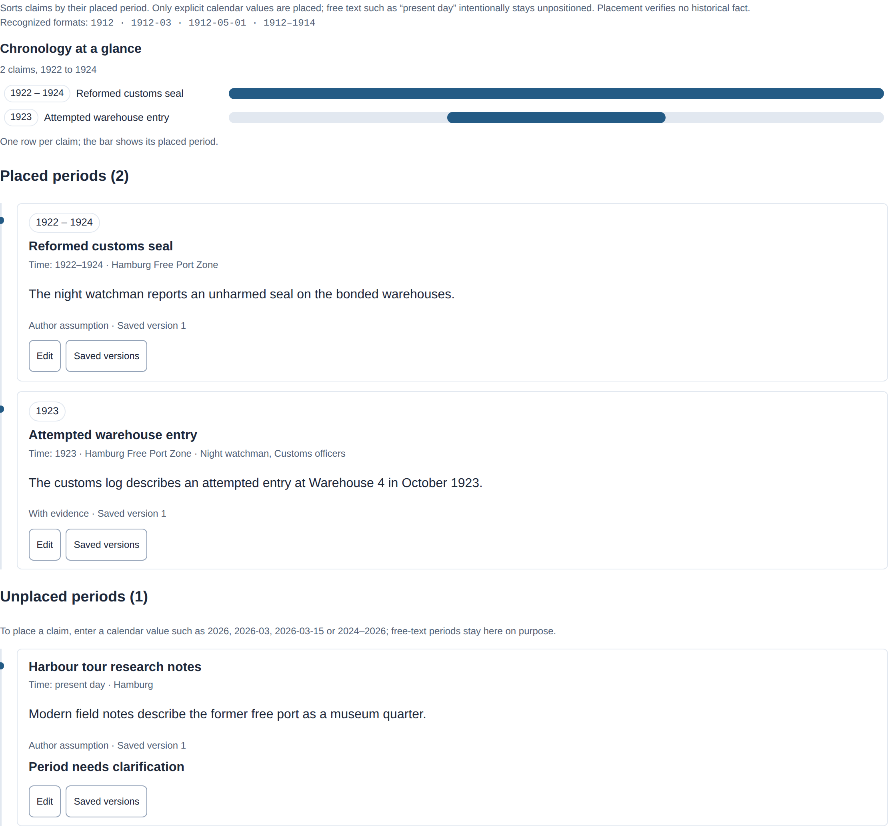

# Connect research to your manuscript

Collect sources, read and annotate in Zotero. Use Lixity's research workspace to connect selected evidence with claims, authorial decisions and exact manuscript quotations. A capture preserves the source version you used; it does not establish that a claim is true.

Maintained by the Lixity project · Updated 19 October 2026

**Before importing:**

Choose the intended project and confirm that you may keep the source bytes. Text PDFs need Poppler; image-only scans need local Tesseract or a configured OCR worker. See

[installation](installation.html#install)

and

[PDF requirements](#ocr)

.

## Export a manuscript as PDF

Open **PDF export** above the workspace views, choose a purpose and select **Download PDF**. The same composer serves the browser and CLI; downloads create no server export files and change no manuscript. Standalone HTML has no download action.

**Since v0.7.0:** the initial choice is an A4 editorial copy with line numbers and a correction margin. Compare the same six chapters of *The Crate at Warehouse 4* in all four prepared files below; these are exports from the shared demo project.

- **Editorial copy:** A4, readable text and space for annotations. [Example PDF](../demo/warehouse-4-editor.pdf).

- **Reading copy:** A5, chapter openings and continuous reading. [Same excerpt](../demo/warehouse-4-book.pdf).

- **Submission sheets:** A4, at most 30 lines of 60 characters. [Same excerpt](../demo/warehouse-4-sheet.pdf).

- **Analysis report:** metric tables rather than the manuscript. [Complete report](../demo/warehouse-4-report.pdf).

```
lixity pdf manuscript.md --layout editor -o editorial.pdf
lixity pdf --help
```

Manuscript copies retain subheadings, scene breaks, lists, quotations, inline emphasis and endnotes. A bounded set of embedded LaTeX text commands is supported without executing TeX. Unsupported TeX constructs fail explicitly; mathematics and image placement are unavailable. Host TrueType fonts keep supported text searchable and copyable. Missing glyphs identify the font role and Unicode codepoint; there is no mixed-script fallback, contextual shaping, bidirectional layout or PDF/X preflight. See [options and limits](../USAGE.md#lixity-pdf).

## Enter publication details

Open **Project → Settings → A5 book PDF details** in the native workspace. This optional section starts collapsed and requires an explicit project. Title, author and publication data use the existing configuration and PDF composer. Select the inclusion checkbox to add entered imprint text after the A5 reading copy's title page. A4 editorial copies, submission sheets and reports omit it; all-empty fields add no blank imprint page. Long entries can continue across pages.

Enter publisher/self-publisher name and address, printer name and address, edition, year, print and digital ISBNs, rights notice, credits or other information as needed. Every text field defaults to empty. Lixity checks syntax and bounds, not assigned ISBNs, rights or legal completeness, and supplies no inferred identity, address, copyright notice or DNB catalog claim. See the [complete configuration contract](../USAGE.md#publication-settings).

**Apply** saves title, author and publication together in the selected project's `lixity.toml`; language and analysis controls keep their session behavior. The updated view is prepared before metadata is committed. Failed validation, reading, rendering or replacement keeps the previous metadata and active view. Reload after a project/config change so the form and PDF export use the current context.

For print in Germany, requirements depend on the Bundesland. [BayPrG Article 7](https://www.gesetze-bayern.de/Content/Document/BayPrG-7) and [NRW § 8](https://recht.nrw.de/lrgv/gesetz/18052021-pressegesetz-fuer-das-land-nordrhein-westfalen-landespressegesetz-nrw/) require printer/publisher names or business names and addresses, with author/editor identity for self-publishing. Enter the actual publishing identity separately from a pen name.

Digital provider/website duties are separate. [MStV § 18](https://www.gesetze-bayern.de/Content/Document/MStV-18) addresses name/address information beyond purely personal or family telemedia; [DDG § 5](https://www.gesetze-im-internet.de/ddg/__5.html) adds contact and applicable business disclosures for businesslike digital services normally offered for payment. Check the provider and distribution channel: every ebook does not automatically need every website field. Lixity does not publish or validate a website imprint.

[ISBNs are voluntary](https://german-isbn.de/faq/faq-isbn); separately available print, PDF and EPUB formats use distinct numbers when assigned. Lixity compares canonical identifiers, so equivalent ISBN-10 and ISBN-13 forms cannot identify two different formats. A rights notice is optional: [copyright generally arises without formalities](https://www.wipo.int/en/web/copyright/faq-copyright). [Legal deposit](https://www.gesetze-im-internet.de/dnbg/__14.html) is a separate publication process that Lixity does not perform.

[BFSG § 1](https://www.gesetze-im-internet.de/bfsg/__1.html) covers consumer e-book services provided after 28 June 2025; [§ 3(3)](https://www.gesetze-im-internet.de/bfsg/__3.html) exempts microenterprises providing services. Scope and exceptions must be checked for the publication. Lixity exports fixed-layout A5 book/A4 sheet/A4 report PDFs, without EPUB, PDF/UA or PDF/X certification. Searchable text, metadata and bookmarks do not establish BFSG compliance.

**Since v0.3.0:** PDFs share title/author/language metadata and corrected font subsets. A5 chapters have bookmarks; body pages have bounded running headers and physical folios. Title/imprint pages have no running decorations but still count toward folios. A4 sheets and reports show current/total page counts outside the body grid.

## Import a local source

Start with a source you are allowed to retain. This synthetic example assumes you saved a short note as `source.txt`. Initialize only a new research archive:

```
lixity research init --project ./sample-project --title "Sample research" --language en
lixity research ingest --project ./sample-project --file ./source.txt --allow-retention --origin-url https://example.org/archive/source
# Or import several files with phase-change messages:
lixity research batch-ingest --project ./sample-project --allow-retention --progress ./sources/*.txt
lixity research search --project ./sample-project --query "reading room"
```

`--allow-retention` confirms your permission to keep source bytes locally. It neither grants redistribution rights nor makes a claim true. Avoid importing sensitive sources into public repositories.

For an authorized file outside Zotero, expand **Research → Evidence captures → Alternative: import a local source**. Choose a text or PDF file, or paste text, and confirm retention. A failed submission keeps the draft. If all active sources are linked to Zotero, use Zotero capture instead; direct import remains available through the CLI/API.

For a visual reference, open a dossier and choose **Add image**. Preview an authorized local PNG/JPEG, describe it and confirm retention before saving. The original image and dossier version are saved together. Earlier versions keep their exact image; removed images show an unavailable placeholder. Images have no extracted text or linguistic scores. See [format limits and archive compatibility](../research/USAGE.md#keep-a-visual-reference-in-a-dossier).

## What does the origin URL do?

This field records the original HTTP(S) address in source details and citations. Lixity does not fetch the page or monitor it. Use a stable public address where appropriate; credentials and whitespace are rejected. Do not include private access tokens or signed download links.

Matching URLs do not merge sources. Refreshing a named source with a new URL creates a new capture; earlier citations keep their original text and URL. These captures use the v2 archive format. Back up before upgrading and use compatible readers and writers; see [archive compatibility](../research/USAGE.md).

## Keep source work in Zotero

Zotero owns bibliographic metadata, ordinary reading, annotations and general notes. Lixity's attachment selector captures only the evidence versions needed for your project; **Open in Zotero** returns to the source for further work.

Run Zotero on the same computer and download the attachments you need. Open **Research → Evidence captures → Capture from Zotero**, choose a library and collection, inspect an item, select an eligible attachment and confirm retention. Lixity reads the local API without changing the Zotero library. Since v0.7.0, eligible attachments include PNG/JPEG alongside PDF/text. Audio, video and unsupported attachments remain in Zotero.

Captured evidence stays readable when Zotero is closed. Refresh linked sources explicitly when they change; old quotations stay intact. There is no background synchronization. Zotero captures need the v3 archive format, which older readers cannot open.

To bring existing Lixity sources into Zotero, `research zotero-export` creates a RIS import bundle with retained files and their identifiers. Export preserves the Lixity archive. Follow the [setup, migration and compatibility reference](../research/USAGE.md#zotero-desktop-bridge-since-v1190), and verify imported files before relying on the new workflow.

## Read a place alongside its sources

In the [Warehouse 4 demo project's Research view](../demo/report.html#research-manager), open **Warehouse 4 case notes** to inspect the historical Hamburg map, photochrom, source links and authored walking/driving sketch. Its claim, customs-log passage and saved manuscript quote belong to the same project used by Analysis and the PDF copies. The historical images do not establish the invented event or journey.


*Historical visual references stay attached to exact source versions. [Mobile map view](../screenshots/dashboard-dossier-image-mobile.png) · [Harbour photochrom](../screenshots/dashboard-dossier-photo.png) · [Places and journeys](../screenshots/dashboard-dossier-geography.png) · [Credits and file hashes](../assets/research/sources.json).*

Use **Places and routes** in the dossier editor for named points, paths and areas. Maps open with OpenStreetMap; turn off the background or choose the numbered sketch for offline use. Tile requests disclose the viewed area and client IP to the provider and stop outside the visible map/project context. The view explains its measurements and limits; historical map images remain separate evidence. See [geography and v8 compatibility](../research/USAGE.md#keep-places-and-journeys-in-a-dossier).

Images and rendered diagrams share a [local zoom viewer](../screenshots/dashboard-dossier-image-zoom.png). [Mermaid diagrams](../screenshots/dashboard-dossier-diagram.png) retain their source; restricted or unsupported syntax stays readable as source. No CDN or diagram upload is required.

## Search sources and current notes

The dashboard Search tab includes sources and current dossiers, claims and decisions. Choose a narrower scope when needed, then use **View details** to read a result. Search refreshes an outdated index automatically; `--strict` reports an error instead. Only source passages can be cited as evidence.

```
lixity research search --project ./sample-project --query "inspector" --scope all
lixity research search --project ./sample-project --query "inspector" --scope decisions
```

The CLI defaults to source passages. Search matches words in current records, not their history; it does not reconcile conflicting claims or decide whether a proposal is final. Keep decisions and open questions explicit in your notes.

## Choose a citation by keywords

**Since v3.0.0:** select a claim in the evidence form and choose **Find source passage**. Search opens with **Sources** selected and keeps your claim choice. Read a match, choose **Use for claim**, then review the full paragraph, select the evidence relation and save explicitly. A search match or draft does not verify a claim or create a saved link.

```
lixity research cite --project ./sample-project --query "reading room"
# For multiple matches, repeat the same query and displayed snapshot:
lixity research cite --project ./sample-project --query "reading room" \
  --pick 2 --expected-snapshot SNAPSHOT_SHA256
```

One match resolves the existing full-paragraph citation. Zero or multiple matches return search JSON and exit `1`; multiple matches print numbered choices on stderr. A numbered choice requires the same query and displayed snapshot. Changed snapshots or unavailable sources require another search. Exact `--passage` retrieval remains available for historical captures. See the [selection and API reference](../research/USAGE.md#choose-citations-by-keywords-since-v300).

## Organize claim periods and causal interpretations

**Since v3.0.0:** inside **Claims**, choose **Timeline**. It places valid four-digit CE years, `YYYY-MM` months, ISO dates and supported ranges while preserving your original period labels. Missing, unclear or invalid periods remain visible under **Unplaced periods**. Reading makes no archive changes, and creation dates never stand in for historical periods.

The timeline sorts claims by the calendar value in their period and shows how the placed spans relate. Every dated claim is one row on a shared axis; the badge repeats its placed range and **Placed periods** lists the full cards below. Free-text periods such as *present day* are not calendar values, so they stay under **Unplaced periods** with a reason and a formatting hint. To place a claim, enter a value like `1926`, `1926-03`, `1926-03-15` or `1924–1926`; the claim form shows these formats and a save reports an unplaceable period as a warning. The axis shows only what you entered — placement never verifies a historical fact.

[Video walkthrough](../videos/research-timeline.mp4)

*Short walkthrough: open **Claims**, switch to **Timeline**, follow a row to its claim and read the placement hint ([also as GIF](../videos/research-timeline.gif)).*



*The chronology strip, placed cards and the placement hint in one view.*

Under **Cause and effect claims**, choose a proposed cause and effect, review their saved versions and save your interpretation explicitly. A later claim edit leaves the link pinned to its earlier versions and marks it for review. Edit or retract through the shared revision editor; earlier interpretations remain in history. Self-links are rejected, cycles are allowed, and no causal truth or additional links are inferred.

**Before the first causal save:**

back up the complete archive. A saved causal link opts storage into v6, supported by v0.3.0 and historical v3.0.x readers. Require explicit archive-schema support rather than comparing product version numbers. Existing v1–v5 archives remain readable without conversion; read-only views do not upgrade them. Export/restore preserves all accepted history. These additions are not in v2.4.0.

```
lixity research timeline --project ./sample-project --format text
lixity research relate --project ./sample-project FROM_CLAIM TO_CLAIM \
  --relation causes --rationale "Author interpretation for review"
```

Replace the claim placeholders with complete IDs from the claim list. `results_in` is an alias for `causes` in the same cause-to-effect direction. Software consuming claim lists must update to the uniform `research-claims-local/2` envelope; stored claims remain unchanged. Read the [3.0.0 release notes](../releases/v3.0.0.md) and [implemented chronology and compatibility reference](../research/USAGE.md#claim-chronology-and-causeeffect-links-since-v300).

## Prepare evidence from selected source text

**Since v2.4.0:** open a retained source and select text within one uniquely resolved paragraph. The selection action prepares the existing claim evidence-link form. Its preview shows both your selected quote and the full retained paragraph; choose a claim and relation, add your own rationale if needed, then save separately.

The saved citation still identifies the whole paragraph and its source version. It creates no sentence-level citation. Cross-paragraph or ambiguous selections are unavailable; use the whole-passage actions in the Passages view instead. Selecting text or opening the draft writes no record. Evidence status labels express your own assessment, not historical certainty or a computed probability.

For reading notes against the manuscript, open **Dossier alongside** in Manuscript and choose a dossier, or use the action on that dossier's card. The optional companion reader is read-only. Closing it preserves manuscript search and open paragraphs; refresh explicitly for the latest saved dossier version. Narrow screens place the dossier above the manuscript.

## Use the intended research project in the terminal

**Since v2.4.0:** existing-archive commands may omit `--project` only when your current directory is itself a validated initialized research project. Lixity does not search parent folders or reuse the browser's last project. An explicit `--project` remains authoritative. Initialization still names its project.

```
cd ./sample-project
lixity research search --query "reading room"
lixity research link urn:uuid:YOUR-PASSAGE-UUID urn:uuid:YOUR-CLAIM-UUID --relation contextualizes
```

Use returned IDs, passage first and claim second. v0.7.1 also accepts complete bare UUIDv4 selectors and exposes plural aliases in grouped help. The short command creates an evidence link; `link-evidence` retains inspection and revision operations. See [scope and compatibility](../research/USAGE.md#reading-and-cli-workflows-since-v240).

## Associate manuscript text with a claim

**Since v0.3.0:** select text within one opened manuscript paragraph, choose **Link selection to claim**, choose a current claim, permit local retention of the quote and select **Save association**. Previewing writes nothing. Saving keeps a manual association to the exact claim version, with the quote and paragraph anchor; it does not import the complete manuscript or edit prose.

Exact resolved quotes are marked when their paragraph opens. Changed text or claim versions request review; an edit outside the quote resolves as *adjusted* and can be re-pinned explicitly in the review tab (or with `reconcile-manuscript --accept-moved`), while edited quotes and ambiguous paragraphs remain unresolved. Saved associations are listed in the research **Review** tab with their anchor state and review flags; listing them never writes or repins. These flags do not establish a contradiction or factual support. Both dossier readers show current linked claims with saved-version history and active saved quote counts. Zero saved links does not establish that a claim is unused in prose.

**On current main (Unreleased):** a paragraph's **… → Saved research**, saved-association count or marked quotation opens saved context beside the manuscript. Read its exact claim and dossier versions and the author's confidence assessment. Associated decisions are labelled as current dossier context; they are not a reconstruction of that quotation's historical state. Titles open the displayed versions, and **Review** opens the dedicated anchor review. The summary shows up to five associations with their total. Opening it writes nothing, and an empty summary means only that this passage has no saved associations.

**Before the first save:**

back up the archive. Retention-confirmed manuscript links opt storage into v7, supported by v0.3.0 but not historical v3.0.1. The lower product number describes development maturity; archive and response schemas keep independent versions. Exported quotes remain private manuscript material. See

[anchoring, retention and compatibility](../research/USAGE.md#associate-a-manuscript-quote-with-a-claim)

.

## Can Lixity read scanned PDFs?

A PDF with selectable text can use local Poppler tools. An image-only scan needs locally installed Tesseract or a configured OCR worker to recognize text. Installing Lixity does not install either engine, download a model or start a worker service.

```
lixity research ocr-status
lixity research ingest --project ./sample-project --file ./document.pdf --allow-retention
```

Diagnostics identify missing tools, language data and configuration errors with corrective guidance. A ready engine or successful synthetic probe does not measure recognition accuracy; automation must inspect `probe.ok`, not just the exit code. See [diagnostic states and failure semantics](../research/USAGE.md#native-pdfs-versus-scans).

Install `poppler-utils` on Debian/Ubuntu or `poppler` with Homebrew on macOS. The server must be able to find `pdftotext` and `pdftoppm`. Check extracted quotations against the original PDF; configuration checks do not measure recognition accuracy.

Scans can use locally installed Tesseract without a separate worker service. Set `LIXITY_OCR_BACKEND=tesseract` and choose installed language data with `LIXITY_OCR_LANGUAGES` (default `eng`), then restart the server. Diagnostics list missing languages. New native Poppler and local Tesseract captures require a v4 archive reader; existing cached provenance stays unchanged. [Local OCR setup and compatibility](../research/USAGE.md#use-local-ocr-without-a-worker-service).

## Connect an existing self-hosted worker

This is optional technical setup for a separately maintained model adapter. The [deployment guide](../research/OCR_INTEGRATION.md) explains the worker boundary and records the retired CPU experiment. Baidu's tools cannot be used directly as a Lixity worker.

Set `LIXITY_OCR_WORKER` to one executable path, not a shell command. The default timeout is 120 seconds; `LIXITY_OCR_TIMEOUT` accepts 1–3600 seconds. A configured worker failure or incomplete result rejects the import unless native fallback is explicitly allowed. Native extraction can omit scanned pages in mixed PDFs; inspect its page warnings. See the [worker interface and limits](../research/USAGE.md#self-hosted-pdf-and-ocr-extraction) for the JSON contract.

```
export LIXITY_OCR_WORKER=/absolute/path/to/ocr-worker
lixity research ocr-status
lixity serve /absolute/path/to/project --host 127.0.0.1 --port 8765
```

These commands use a POSIX shell. Use equivalent environment settings on Windows or in a service, then restart the server. Test a synthetic scan and compare its extracted quotation with the page.

Lixity retains the original PDF and extracted text separately. Citations identify spans in that text; they do not provide audited page coordinates or recognition confidence. Consult the original when visual evidence matters.

## Back up and test restoration

The project's `research/` folder contains the evidence archive. The search index can be rebuilt and is not a backup. Keep backups outside public repositories and avoid writes while exporting.

```
lixity research export --project ./sample-project --output ./sample-backup.tar.gz
lixity research restore --from ./sample-backup.tar.gz --to ./restored-sample
lixity research audit --project ./restored-sample
lixity research reindex --project ./restored-sample
lixity research search --project ./restored-sample --query "reading room"
```

Restore into a new, empty target. Restoration checks paths, checksums and record links. Resolve a known passage afterward to check its quotation and original URL. A successful audit checks archive integrity, not historical truth or permissions.

`research zotero-backup` pairs the archive with a selected Zotero data folder; you must close Zotero first. `research zotero-restore` verifies and restores both into a new directory without replacing a working library. Manuscripts, application profiles and external linked attachments need separate backups. Test a restored citation and follow the [backup reference](../research/USAGE.md) before relying on the pair.

## Command-line example: sources to decisions

**Since v0.7.1:** for authored notes, use the explicit [Markdown export → edit → preview → apply workflow](../research/USAGE.md#edit-an-exported-markdown-dossier). The archive stays authoritative; a reviewed packet binds its project and snapshot. Exact update dry runs validate a proposed write, historical diffs compare saved revisions, and three-way preparation reconciles a draft. Source ingest is separate and does not create authored notes from Markdown exports.

This optional example uses authorized local source files. Replace paths and UUID placeholders with the files and identifiers returned by earlier commands. Initialize the archive only once, and prepare `./sources/harbor-dossier.md` before importing that dossier.

**Show the complete command-line example**

```
# 1. Initialize a dedicated research workspace
lixity research init --project ./novel-research --title "1920s Archive" --language en

# 2. Ingest primary source with cultural source criticism and explicit retention
lixity research ingest --project ./novel-research --file ./sources/police_log_1923.txt \
  --context '{"genre": "Police Log", "created_period": "1923", "place": "Hamburg", "provenance_note": "State Archives"}' \
  --allow-retention

# 3. Rebuild search explicitly (ordinary search refreshes it automatically)
lixity research reindex --project ./novel-research

# 4. Search source passages; add --scope all for current authored records
lixity research search --project ./novel-research --query "dockyard customs" --limit 5

# 5. Resolve a passage citation (paragraph, exact offset, source metadata)
lixity research cite --project ./novel-research --passage urn:uuid:PASSAGE-UUID-HERE

# 6. Run linguistic source analysis and generate standalone source dashboard
lixity research analyze --project ./novel-research --source-id urn:uuid:SOURCE-UUID-HERE
lixity research dashboard --project ./novel-research --source-id urn:uuid:SOURCE-UUID-HERE > source_report.html

# 7. Compare source and manuscript vocabulary; create a dossier
lixity research compare --project ./novel-research --source-id urn:uuid:SOURCE-UUID-HERE --manuscript ./manuscript.md
lixity research dossier --project ./novel-research --title "Harbor Evidence" --file ./sources/harbor-dossier.md --tags "harbor"

# 8. Record a claim, passage relation, and authorial decision
lixity research claim --project ./novel-research --title "Harbor opening" --statement "The harbor opened in 1923." --confidence hypothetical
lixity research link-evidence --project ./novel-research --claim-id urn:uuid:CLAIM-UUID-HERE --passage-id urn:uuid:PASSAGE-UUID-HERE --relation supports
lixity research decision --project ./novel-research --title "Shift opening date" --rationale "Narrative chronology" --claim-id urn:uuid:CLAIM-UUID-HERE --deviation-from-fact

# 9. Open a foreground research dashboard (stop with Ctrl+C)
lixity serve --research-project ./novel-research --no-project

# 10. Audit repository integrity and snapshot checksums
lixity research audit --project ./novel-research
```

For the managed app instead, use `lixity service start --open` and **Open Project** to select the archive. See the [lifecycle guide](installation.html#restart).

## Input and research limits

Text inputs must be nonempty UTF-8 without NUL bytes, up to 2 MiB; PDFs can be up to 50 MiB. Imports allow at most 5,000 nonempty passages. Search matches words using SQLite FTS5/BM25; it does not translate text or search by meaning. Refreshing a source does not automatically update your claims or decisions.

See the [implemented research reference](https://github.com/mfahsold/lixity/blob/main/docs/research/USAGE.md) for CLI/API details. The broader [research RFC](https://github.com/mfahsold/lixity/blob/main/docs/research/README.md) includes unimplemented interfaces. Read [metric interpretation](interpretation.html) before comparing a source with a manuscript.

[All guides](../#guides) · [Lixity home](../) · [License and commercial use](https://github.com/mfahsold/lixity/blob/main/docs/LICENSING.md) · [Legal notice](../#impressum)
