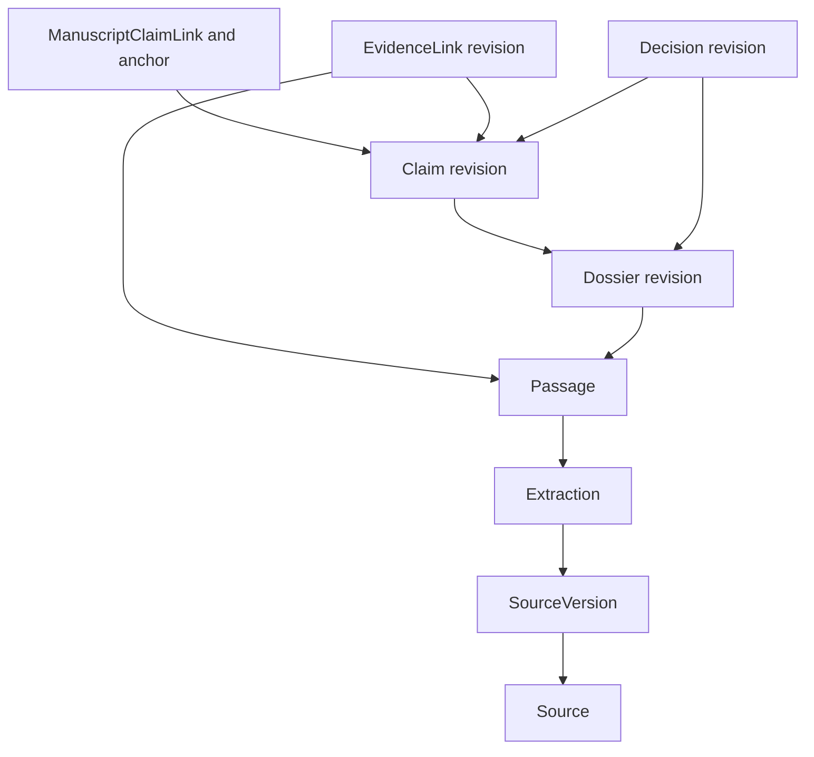
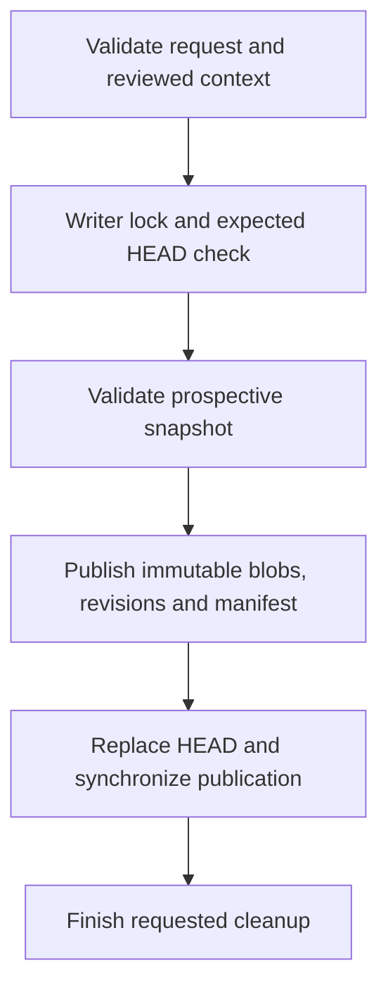
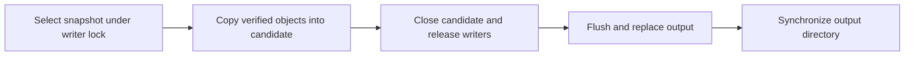

# Local research data model and storage contracts

[Research usage](USAGE.md) owns workflows; [architecture](../ARCHITECTURE.md)
owns component boundaries. This document describes the implemented local model,
not the broader interchange proposal. Inspect installed entity definitions with
`lixity research schema` and supported contracts with `lixity about --json`.
Product, entity, manifest and response versions are separate.

## Authority and identity

| Stored data | Responsibility | Recovery rule |
| --- | --- | --- |
| `research/revisions/<kind>/<id>/<revision>.json` | Immutable, strictly validated entity revisions | Never replace an accepted revision |
| `research/blobs/<sha256>` | Retained originals and extracted text, addressed by exact bytes | Preserve every blob still referenced by an accepted record |
| `research/manifests/<sha256>.json` | Accepted revision references and byte hashes, project, generation and parent | Validate complete accepted ancestry on backup/restore |
| `research/HEAD.json` | Selects one accepted manifest | Atomic publication point; never select objects by modification time |
| `research/project.json` | Immutable initial project configuration, checked against its accepted record | Restore with the archive |
| `.lixity/research/catalogue.sqlite3` | Disposable lexical search projection | Rebuild from the accepted snapshot; SQLite alone is not a backup |

Each entity has a UUID URI, kind, project ID, revision, UTC creation timestamp,
creator and schema version. A `Reference` pins both ID and revision. SHA-256
identifies serialized bytes; it does not replace entity identity or establish
factual accuracy. Titles, filenames, URLs and equal quotations do not merge
entities. Successive source captures are separate `SourceVersion` entities with
increasing sequence numbers; authored edits append revisions of one entity.

## Relationships

Arrows point from a record to its stored reference. The manuscript remains an
external project file: its association retains only the explicitly permitted
quotation and anchor, not a manuscript archive blob.

This is the main reading/research chain, not every field or cardinality. Optional
references and the remaining record types are specified below.

| Record | Implemented meaning and references |
| --- | --- |
| `Project` | Explicit project identity, title and language |
| `Source` | Retained source identity, title and language |
| `SourceVersion` | Source capture: `source_ref`, sequence, original blob, confirmed retention and source context |
| `Activity` | Extraction operation, implementation and status, pinned to its source version |
| `Extraction` | Source version, activity and exact UTF-8 text blob; normalization `none`, Unicode codepoint offsets |
| `Passage` | Extraction reference, exclusive `[start,end)` span and exact verbatim text |
| `Dossier` | Authored Markdown, tags, passage `evidence_refs` and optional bounded GeoJSON |
| `Claim` | Statement, optional dossier reference, scope and confidence: hypothetical, evidenced or disputed |
| `EvidenceLink` | Exact claim and passage revisions; supports, contradicts, qualifies or contextualizes |
| `Decision` | Author rationale, optional claim, dossier references and explicit deviation flag |
| `ClaimRelation` | Author-assigned causal relation between distinct claim revisions; active or retracted |
| `ManuscriptClaimLink` | Exact claim revision, retained quote/anchor, active or retracted state and optional note |
| `DecisionAcknowledgement` | Append-only applied/review-needed statement about exact decision/dossier revisions; may supersede an earlier acknowledgement |
| `Tombstone` | Withdrawal or purge, target and reason; source-version purge can retain its owning source identity |

Confidence and causal relations are author assertions, not certification. A
dossier's current claim list is derived from claim associations; it is not a
stored `claim_refs` field. Historical views resolve explicit pins; current reverse
links do not reconstruct the whole archive at an earlier date.

## Validation and publication

`research.models` owns strict discriminated entity schemas, field constraints
and record-version rules. `research.repository` owns cross-record/project checks,
contiguous authored history, immutable publication and the writer lock. JSON
Schema alone cannot establish referential integrity or retained-byte availability.
Citation resolution additionally verifies bytes and exact substrings. Filtered
list reads validate their loaded kinds; they are not a complete archive audit.
Full writes validate the prospective snapshot before publication.

The diagram shows a changed write's acknowledged path. Its early exits and error
outcomes are distinct:

| Outcome | Observed state and caller action |
| --- | --- |
| Expected HEAD differs | Conflict; retain the draft, no accepted write |
| Validated authored update is unchanged | Return its current revision after the locked check, without a write |
| Write fails with uncertain publication | An observed new HEAD or unknown outcome is reported explicitly; review before retrying, with recovery artifacts retained. A confirmed previous HEAD retains the ordinary failure |
| Cleanup fails after acknowledgement | Report the accepted snapshot and pending artifacts; do not repeat the write or claim completed erasure |

Ordinary authored updates request no artifact deletion. Ingestion, purge and
append-only acknowledgements have their own inputs and lifecycle effects.
Previews do not reserve a snapshot. A later save must still pass the locked comparison. Failed
drafts are never automatically retried or repinned to newer evidence. Since
v0.7.2, unchanged authored updates return their accepted revision after validation
and the locked check; acknowledgements remain append-only events.

Files are flushed before publication, with directory syncing on POSIX. Local
filesystem/OS guarantees still apply; this is not a distributed transaction.
An interruption before HEAD publication leaves the prior snapshot selected.
Unaccepted files may remain for recovery; they do not prove a save succeeded.
A cleanup failure after acknowledged publication cannot roll back the accepted
HEAD. If replacement was visible but its synchronization failed, publication
durability is uncertain; an unreadable HEAD leaves the outcome unknown. These
states must not be described as a write that definitely never happened. Preserve
valid interrupted authored revision bytes rather than overwriting them.
See [recovery](USAGE.md#export-and-restoration).

## Search database and deletion

`research.catalogue` builds a new SQLite database from one accepted snapshot under
the project writer lock, then closes, flushes and atomically replaces the cache.
A `metadata` table records the snapshot digest. Two FTS5 projections serve source
passages and current searchable passages/dossiers/claims/decisions; they are not
relational storage for domain entities or citation authority.

Search opens the cache read-only with `trusted_schema=OFF`, uses bound query
parameters and checks its recorded digest against the accepted snapshot. Missing,
stale indexes can be rebuilt when the caller requests refresh; otherwise they
fail explicitly. Structurally unusable caches may require explicit reindexing.
Returned references resolve against that snapshot, with lifecycle/current-source
checks. Lexical rank is not a truth probability. Current search excludes
withdrawn/purged sources and withdrawn dossiers; historical citations retain
their distinct availability rules.

Original-source and extracted-text descriptors both participate in blob
reachability. Equal bytes can be shared across either role and across sources;
purging one source must retain every blob owned by another accepted record.
Physical deletion and rebuilding a cache are separate from accepting a new HEAD.
Backups include authoritative records, manifests and blobs, not SQLite or locks.

**Since v0.7.3:** backup creation holds the existing project
writer lock until accepted records and blobs have been copied into a closed
compressed candidate. This includes protection from concurrent purge. The
candidate carries the selected HEAD and initial project bytes, with verified
content addresses and an exact copied-byte inventory. Writers are released before
external output publication:

Failure before replacement preserves the old output. Failure after replacement
reports published output with uncertain durability; it does not claim rollback.
Restore validates the metadata object and inventory before selected-path reads.
No entity/manifest migration or archive-format change is involved.

## Schema evolution and compatibility

The local reader supports entity/manifest versions 1–8. These are capability
levels, not migrations of every existing file. Writes opt into the format their
new records require; reads do not upgrade archives. Existing encodings and
historical pins remain intact. Unknown fields and unsupported versions fail
rather than being silently discarded.

| Capability | Local format requirement |
| --- | --- |
| Initial records and source/extraction chain | v1 |
| Authored replacement revisions; capture origin URL; owned source-version purge tombstone | Relevant v2 record contract |
| Structured local Zotero capture identity | v3 source version and manifest |
| Local Poppler/Tesseract extraction activity | v4 activity and manifest |
| Decision acknowledgement | v5 record and manifest |
| Claim causal relation | v6 record and manifest |
| Manual manuscript quote–claim association | v7 record and manifest |
| Structured dossier geography | v8 dossier and manifest; subsequent revisions retain v8 |

Versions are scoped to each entity model: a v2 source capture is not a v2 authored
revision. The manifest retains the highest capability already accepted. HEAD
remains `research-head-local/1`; backup, search, preview and HTTP envelopes have
independent identifiers. Keep a complete verified backup before the first
higher-format write; an older application can reject that archive even if its
product number is larger. [Compatibility](USAGE.md#limits) records those boundaries.

## Proposed work is separate

The [original interchange model](https://github.com/mfahsold/lixity/blob/427e2a3491bacd0b504ce4e3387a019340bd2e67/docs/research/DATA_MODEL.md#1-common-envelope-and-identity)
preserves the broader schema, selectors, interoperability mappings and synthetic
example. Its `research-search/1`, claim review/status fields, PROV/RO-Crate,
Qdrant and general manuscript targets are proposals, not accepted local payloads.
The [synthetic interchange example](examples/evidence-chain.json) illustrates that
proposal; it is not a local database export.

The [knowledge-horizon RFC](KNOWLEDGE_HORIZON_RFC.md) remains unimplemented.
Semantic retrieval, automatic factual certification, background synchronization
and an explicit planned/unwritten scene state are not current capabilities.
Future extensions must define their authoritative owner, references, failure
states and compatible read/write boundary before adding a projection or UI.
