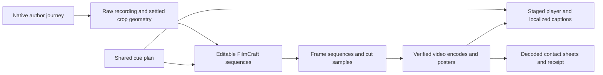

# Product video production

The guide walkthroughs and homepage tour show the synthetic Warehouse 4
workspace. The public-domain case studies have their own reports.
[Effi Briest](../examples/effi-briest.html) · [Pride and Prejudice](../examples/pride-and-prejudice.html)

Use this runbook from the Lixity checkout. Agents can start with the
[Lixity FilmCraft skill](https://github.com/mfahsold/lixity/blob/main/skills/lixity-filmcraft/SKILL.md).

## Choose the work

| Change | Capture and verification |
| --- | --- |
| New product action, changed UI, language or capture timing | Exercise the real workflow in a disposable project, record it and rebuild the affected outputs. |
| Website action such as trying the demo or finding a download | Use the [local staged Pages preview](https://github.com/mfahsold/lixity/blob/main/CONTRIBUTING.md#generate-and-preview) and a fresh browser context. Verify that the displayed route reaches its intended destination. |
| Crop, on-frame typography or edit timing within the existing take | Reuse the verified recording when it still matches the shown UI and contains the full action. Rebuild and inspect the affected outputs. |
| Website player, poster selection or caption copy | Exercise the staged player with the current media. When changing cue times, update the shared plan and keep the visible actions in sync. |
| All reviewed guide clips and the product tour | Run `make videos`, then synchronize and review the site. |

For a new beat, note the viewer's question, the starting state, the visible
action, the confirming result and the next destination. Plan the crop and
read time for each format. Use colors and transitions to follow the action.
Keep complete controls in frame and use a separate inset only if it adds
useful context. A source document or dialogue prop belongs inside the actual
product view when its role could be mistaken for a feature.

Record from fresh browser contexts and a temporary project or a staged site.
Use synthetic or reviewed public-domain material. Check what browser chrome,
download names, prompts and tooltips reveal. Keep raw takes and review material
in `.artifacts/`. Maintain the approved outputs and timing plan in `docs/videos/`.

### Capture a new journey

Use `scripts/capture_screenshots.cjs` and `scripts/product_tour_capture.cjs`
as the Playwright entry point and native recording example. For a website
journey, start the staged site on loopback and visit its normal entry URL.
Record at the viewport and theme the film will show. Wait for fonts, act on
the visible control and check the visible result or downloaded artifact. Keep
actions inside the disposable project or staged preview where possible. Record
the build, URL or project, viewport, theme and locale alongside the take so a
reviewer can reproduce the starting state.

When the reading-website export changes, run the targeted browser checks in
`tests/browser/site-preflight.cjs` and `tests/browser/read-only-site.cjs`
with the development `PYTHON_BIN` before recording the updated dialog.
`--only product-tour` records the continuous author journey, including the
new dialog and the reader copy it produces.

## Guide walkthroughs

| File | Purpose |
| --- | --- |
| `research-timeline.mp4` | H.264 video embedded in the research guide |
| `research-timeline.gif` | Loop for the README and chat previews |
| `research-timeline.png` | Poster frame and video thumbnail |
| `analysis-review.mp4` / `.gif` / `.png` | Chapter cell, paragraph Values and style dimensions walkthrough |
| `editorial-loop.mp4` / `.gif` / `.png` | Flagged passages, an opened paragraph and a marker note written on the passage |

The recorder overlays short step captions in the three guide walkthroughs.
The raw take includes a capture marker after the first guide view is ready.
The encoder verifies the recording's hash and starts at the first frame after
that marker. MP4, GIF and poster all use this trimmed take.

Use the development environment and install pinned Chromium and Playwright
with `make browser-tools`. Guide builds use FFmpeg with `libx264` and `ffprobe`.
To update one guide, use its stem as `--only` for both the recorder and encoder.

```sh
.venv/bin/python scripts/make_screenshots.py --video --only editorial-loop
.venv/bin/python scripts/make_videos.py --only editorial-loop
make docs-sync
```

`scripts/stage_pages.py` stages the reviewed files listed in
`scripts/make_videos.py`. Review the encoded recording and verify that it
contains only the approved fictional project before committing it.

## Homepage product tour

**Why is this sentence marked?** follows one revision in the fictional
Warehouse 4 manuscript. The 74-second tour starts in the running workspace and
leads through the teleprompter recording flow to the exported reading copy.

| Time | Story and evidence |
| --- | --- |
| 0–3 s | Find the marked sentence in the Lixity manuscript view. |
| 3–10 s | Open its explanation and inspect the 22 counted function words out of 31. |
| 10–22 s | Follow the research link from the next paragraph to the saved record. |
| 22–35 s | Type the shorter version and compare the 31-word sentence with the 12-word draft. |
| 35–43 s | Apply the draft, save it explicitly and return to the revised text. |
| 43–52 s | Open the revised passage in the teleprompter and record a local voice take. |
| 52–63 s | Choose the scope of the reading website and check the export. |
| 63–70 s | Open the exported reading copy and check the sentence the reader receives. |
| 70–74 s | Invite viewers to check the same passage in the read-only demo. |

The recorder uses one disposable copy of the English project. It verifies the
counted words, the original text during comparison and the revised sentence
after saving. The reading copy comes from the same workspace and shows the
saved revision. The source documents are fictional facsimiles.

### Type, picture and motion

Use Georgia for the film title and Inter for editorial labels. Open on the
marked manuscript. Alternate the title alignment and place the save heading
below the capture. Give the main action the largest region. Use a smaller
insert for separate workspace context, such as the marked passage and its
analysis controls. Switch insert placement between beats and keep it outside
the main image. These choices are fixed per beat so a rebuild preserves the
composition.

Choose source windows around complete controls, cards and lines of text.
Record new geometry when a menu opens, a dialog changes height or an action
reveals a result. Record both the cue and the time at which the new crop is
ready. FilmCraft holds the outgoing crop briefly and starts incoming footage
after a short recording buffer, preserving the edit cue. Hold each outcome
long enough to read it. Give successive click targets time to register and
carry a shared object across a change of scale. Keep the paragraph and its
action together when they fit in one crop. FilmCraft opacity masks slightly
round and feather the capture edges in source pixels. Selected entrances
use a short fade against the scene background. The two version panes stay at
matched scale during selection and typing, so each line remains sharp.
[Linear Agent](https://linear.app/changelog/2026-03-24-introducing-linear-agent) · [Screen Studio motion](https://screen.studio/guide/animations) · [Carbon motion guidance](https://www.carbondesignsystem.com/building-blocks/foundations/motion/overview)

Show the current and draft passages side by side in landscape and as a staggered stack
in portrait. Both crops use the same source frames while the draft changes.
Review the mobile controls at their actual display size.

In the checkout, the eight cues in `docs/videos/product-tour-timing.json` set
the boundaries for the seven localized on-screen cues and the written walkthrough.
The film is silent, with English labels on the frames. The homepage displays
the localized cues below the video and updates them on seeking. The homepage prefers
the portrait source in portrait viewports, with landscape fallbacks.
Playback respects reduced motion, data saving, explicit pause and page
visibility. Native controls and the written walkthrough remain available.
If playback fails, the page offers the interactive demo.

### Rebuild and review

The tour also uses `ffprobe`, FFmpeg with `libx264` and an AV1 encoder
(`libsvtav1` or `libaom-av1`), and `cwebp` or FFmpeg with `libwebp` for the
landscape poster. Use Georgia Regular and Inter SemiBold. FilmCraft CLI
0.20.1 is the tested baseline and was the latest stable release at the
2026-11-27 review. Check the local version with `filmcraft-cli --version`.
Use the installed CLI's `commands` and `describe` output for its syntax, and
match the upstream documentation to that release tag.
[FilmCraft 0.20.1 release](https://github.com/storytold/filmcraft/releases/tag/v0.20.1) · [CLI reference for 0.20.1](https://github.com/storytold/filmcraft/blob/v0.20.1/docs/agents.md#2b-command-line-interface)

From the checkout root, run the needed stages in order. Parallel builds need
separate checkouts because each checkout shares its recording and output paths.

```sh
.venv/bin/python scripts/make_screenshots.py --video --only product-tour
.venv/bin/python scripts/make_videos.py --inspect-cuts
.venv/bin/python scripts/make_videos.py --only product-tour
make docs-sync
make video-review
make docs-check
PYTHON_BIN="$PWD/.venv/bin/python" node tests/browser/home-tour.cjs --review-frames
```

Use `--variant landscape`, `--variant portrait`, or `--variant social-16x9`
with `scripts/make_videos.py` to rebuild or `--inspect-cuts` a single tour
format. Deterministic FilmCraft project files (`warehouse-4-*.fcproj`),
marker CSVs (`warehouse-4-*-markers.csv`), and receipts (`receipt-*.json`)
live under `.artifacts/filmcraft/warehouse-4-tour/`; stale lock files and
superseded receipts are pruned automatically, and `--no-keep-projects` removes
the `.fcproj` and `*-cuts/` scratch files after encoding.



The browser records one continuous author session. The manifest under
`.artifacts/screenshots/videos/` stores the decoded frame anchor, action time,
settled source time, crop geometry and fingerprints. `scripts/product_tour_edit.py`
assembles the three FilmCraft projects with named tracks for captures, inserts,
titles and brand elements. It checks source availability with `media.status`,
verifies the fonts and checks FilmCraft's actual text quadrilaterals and
overflow flags. Native chapter markers follow the website cue plan. The build
exports and checks a CSV with names, exact ticks and frame rates for each
sequence. FFmpeg encodes the public variants from the rendered PNG sequences.
Offline media, incomplete timing, incorrect geometry and budget overruns fail
the build.

Both website landscape codecs share the 1440×900 sequence. The website and
social portrait MP4s share the 1080×1920 sequence. The horizontal social frame
is 1600×900. Every video has 1,850 frames at 25 fps, square pixels and one
picture stream. The tour encodes retain the capture's sRGB transfer
with explicit limited-range BT.709 video metadata. The file budget is 4 MB,
with 3.5 MB for horizontal social.
The landscape WebP and 1080×1920 portrait posters use the opening scene at
two seconds. `make docs-sync` fingerprints the player sources, posters and
download links while preserving the base filenames.

Editable local projects and FilmCraft review frames are in
`.artifacts/filmcraft/warehouse-4-tour/`. Each sequence's `*-cuts/` directory
holds the exact frames used for encoding, sampled at both sides of each cut
and at the midpoint of each interval, plus every frame of a timed reveal.
Filenames carry the zero-based frame
number at 25 fps. The build receipt next to the projects records input and
output hashes, tool versions, encoder settings, sample frame numbers and the
hashes of the `*-markers-*.csv` reports. `make video-review` checks the current MP4 bytes against their
build receipts and decodes those samples into
`.artifacts/filmcraft/warehouse-4-tour/layout-review/final/`. Use each format's
`index.md` to find the exact frame, timestamp and media hash. For one format,
use `.venv/bin/python scripts/review_product_tour.py --only portrait`,
`landscape` or `social`.
Legacy receipts use the saved `*-cuts/` frame numbers for sampling.

For visual review, follow the timeline in order. Check the first frame, the
poster, both sides of each cut, each sustained view and the final frame.
Play pointer movement, selection, typing and scrolling at normal speed. Step
through consecutive affected frames when something flashes or disappears.
Check the reading time of intermediate states such as the export preflight as
well as each scene's final hold. Judge the visible text at the delivered size.

```sh
tour_review_dir="$(mktemp -d "${TMPDIR:-/tmp}/lixity-tour-frames.XXXXXX")"
ffmpeg -v error -i docs/videos/product-tour-portrait.mp4 \
  -vf "select='between(n,352,357)'" -fps_mode passthrough "$tour_review_dir/frame-%02d.png"
```

- At the first frame and 2 s, identify the question and the manuscript. The
  poster uses the same opening.
- Between 3 and 10 s, check the transition from the marked sentence to the
  count. Between 10 and 22 s, follow the click from the adjacent paragraph
  into its research. Show where the link opens, then frame the claim, pinned
  versions and quotation closely enough to read at feed width.
- Between 22 and 43 s, read the text as it changes in the comparison. Watch
  for the draft and saved states and verify the revised text in the reader.
- From 43 to 61 s, review the export choice and its preflight, then check the
  exported reading copy. After 61 s, verify the demo invitation. Keep both ends
  of each relevant line clear of player controls and social overlays.
- Play the first and last beats on the desktop and phone layouts. Check the
  page captions and transcript against the visible action. Review the
  downloaded formats before preparing social copy.

### Accessible delivery

The current homepage film is prerecorded video-only. For WCAG 2.2 SC 1.2.1,
provide an equivalent text walkthrough or equivalent audio. Read the localized
walkthrough with playback unavailable. It should communicate the relevant
actions and results, including the 22-of-31 count, the passage's retained
claim, the separate apply and save actions, and the export check and result.
Keep on-screen cues and walkthrough timing in step. The cue text describes
what happens on screen. [WCAG 2.2 SC 1.2.1](https://www.w3.org/WAI/WCAG22/Understanding/audio-only-and-video-only-prerecorded.html) · [WAI transcript guidance](https://www.w3.org/WAI/media/av/transcripts/)

If a future cut contains speech or meaningful sound, review synchronized
captions for speech, speaker identification where needed, and meaningful sound
effects. At Level AA, convey essential visual steps in the narration or in
audio description. Review both channels against the final cut.
[WCAG 2.2 SC 1.2.2](https://www.w3.org/WAI/WCAG22/Understanding/captions-prerecorded.html) · [WCAG 2.2 SC 1.2.5](https://www.w3.org/WAI/WCAG22/Understanding/audio-description-prerecorded.html)

The Chromium review checks playback at 390 px and 1440 px viewport widths,
enlarged cue text, keyboard activation, pause, reduced motion and a readable
walkthrough when video requests fail. Check focus visibility and read the
walkthrough with assistive technology when assessing accessibility. For
autoplaying movement lasting more than five seconds alongside other content,
keep a working way to pause, stop or hide it. Review authored text at actual
playback size and aim for at least 4.5:1 contrast for normal text on its
background. [WAI media player guidance](https://www.w3.org/WAI/media/av/player/) · [Pause, stop, hide](https://www.w3.org/WAI/WCAG22/Understanding/pause-stop-hide.html) · [Minimum contrast](https://www.w3.org/WAI/WCAG22/Understanding/contrast-minimum.html)

Review text, controls and the call to action in the intended social placement's
preview. Lixity's internal title margins leave space for overlays. Platform
overlays vary by device, format, caption length and add-ons, so check the
actual placement and keep the preview or screenshots with the handoff.
[YouTube vertical ad overlays](https://support.google.com/google-ads/answer/9128498?hl=en-1-2) · [TikTok in-feed ad guidance](https://ads.tiktok.com/resources/help/article/tiktok-auction-in-feed-ads)

### Diagnose a review finding

| First layer with the problem | Investigate and fix |
| --- | --- |
| Native UI | Verify the control's rendered text and hit area. Fix a real layout defect before capturing that state again. |
| Browser take | Inspect the raw recording around the decoded shot anchor. Check the viewport, full element geometry and scroll offset. A transient drawer or confirmation needs its own settled crop. |
| FilmCraft cut | Inspect the exact `*.fcproj` sequence and render the frame. Check the source clip, crop, title bounds and adjacent layers. Reflect durable changes in the composer. |
| Delivered media | Decode the actual output at its displayed frame index and use its receipt to identify the build. Compare it with the corresponding FilmCraft sample. |
| Staged website | Check which source and poster were selected, then verify timing, captions and surrounding layout in the browser. |

On a fresh checkout without receipts, start with the direct FFmpeg spot
check above and the staged player. For a browser-specific problem, open the
staged page in the affected browser. The automated homepage test uses
Chromium. After playback or a seek, inspect the video's `currentSrc`,
`videoWidth`, `videoHeight` and `currentTime` alongside its rendered size.
Compare that exact asset and moment with the decoded frames before rebuilding.
Use a fresh page load in each orientation to verify source selection. HTML
evaluates `<source media>` when selecting a resource. Test rotation separately
for stable playback and layout. [HTML source selection](https://html.spec.whatwg.org/multipage/embedded-content.html#the-source-element)

### FilmCraft tools

Inspect the generated project and its media before rendering a quick range.
Use a scratch directory for the proof files.

```sh
tour_project=.artifacts/filmcraft/warehouse-4-tour/warehouse-4-1080x1920.fcproj
tour_review_dir="$(mktemp -d "${TMPDIR:-/tmp}/lixity-filmcraft-review.XXXXXX")"
filmcraft-cli --project "$tour_project" inspect sequence
filmcraft-cli --project "$tour_project" exec media.status
filmcraft-cli --project "$tour_project" exec markers.exportCsv path="$tour_review_dir/markers.csv"
filmcraft-cli --project "$tour_project" render --seconds 19 --scale 0.333333 \
  --out "$tour_review_dir/warehouse-4-research.png"
filmcraft-cli --project "$tour_project" export "$tour_review_dir/reader-transition.mp4" \
  --start 54 --end 56 --scale 0.5 --gpu-rendering off --no-audio
```

Use `graphics.list` with the clip ID from `inspect sequence` to check text
bounds and overflow. The short native export is useful for judging motion and
cuts. Its codec settings and transfer metadata can differ from the checked
website and social encodes. Use the project composer and encoder for final
delivery. A headless FilmCraft MCP client can inspect a synthetic `.fcproj`
with `sequence_inspect`. Use the desktop bridge for an explicitly selected
open project when a task needs interactive editing. The
[agent setup](https://github.com/mfahsold/lixity/blob/main/CONTRIBUTING.md#agent-setup-and-verification)
shows how to verify stdio inspection. Reopen the encoded film after each fix
and record the format, time, frame and result in the handoff.

For a narrated cut or a timed-text review, FilmCraft can import and export
WebVTT in a scratch project. Read the track IDs and languages with
`captions.list`, then export the intended language by ID. Keep Lixity's
published cues in `product-tour-timing.json` and `docs/locales/`. For an
editable project handoff, `file.projectManager` in `collect` mode with
`dryRun=true` lists the dependencies before any copy. Inspect that inventory
against the requested sharing scope. [FilmCraft CLI reference](https://github.com/storytold/filmcraft/blob/v0.20.1/docs/agents.md)

#### Evaluate a FilmCraft upgrade

Check the [latest stable release](https://github.com/storytold/filmcraft/releases/latest)
and its changelog before updating the local baseline. Verify the candidate
CLI's commands. Use an isolated render on the same verified take to compare
chapter timing, font and text bounds, source linking, decoded cuts, color and
size. Use file hashes to identify the delivered bytes. If a WebM container
hash changes, compare the encoded video stream and decoded frame hashes.
Record the tested version in the build receipt. FilmCraft's built-in
vertical social presets can preview alternative delivery settings. Use the
existing Lixity encoder to retain the reviewed crops, silent streams and file
budgets for the canonical assets. [FilmCraft social presets](https://github.com/storytold/filmcraft/releases/tag/v0.17.0)

## Social video downloads

`social-hook-16x9.mp4` and `social-hook-9x16.mp4` both contain the full tour.
Their filenames keep existing links valid. The full build copies the website
portrait MP4 byte for byte to the portrait social filename. To rebuild the
portrait variants and their shared poster, run
`.venv/bin/python scripts/make_videos.py --only portrait`. The `--only social`
mode updates that same portrait group and the horizontal social file.
Run `make docs-sync` after either partial build.
The [reviewed asset handoff](../screenshots/README.md#maintain-the-one-package)
packages both formats with stills, text alternatives and byte hashes.
Publish reviewed site media through the
[Pages procedure](https://github.com/mfahsold/lixity/blob/main/CONTRIBUTING.md#publish-and-verify-pages).
